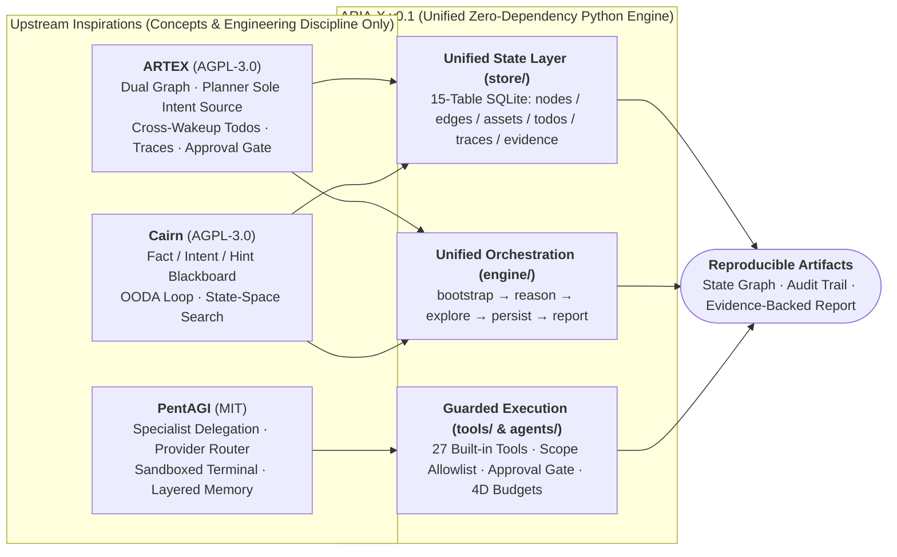
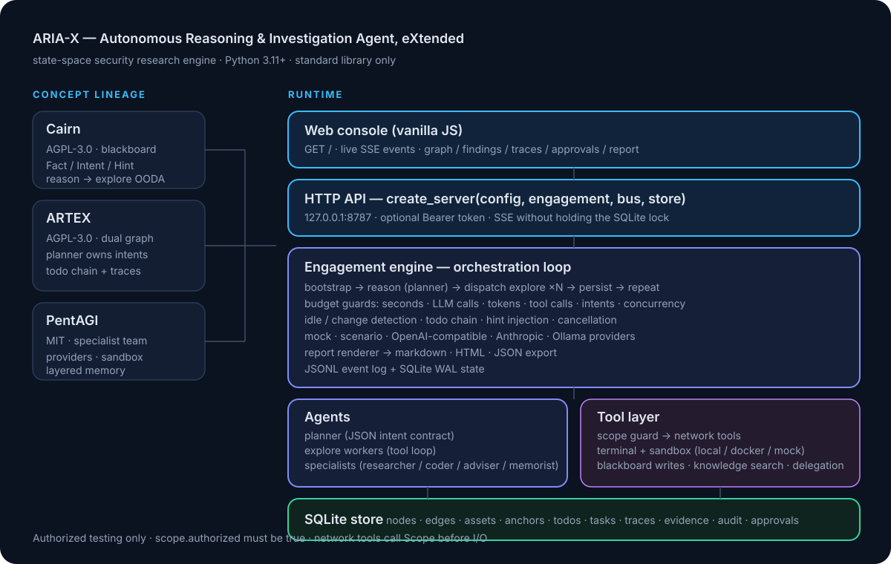
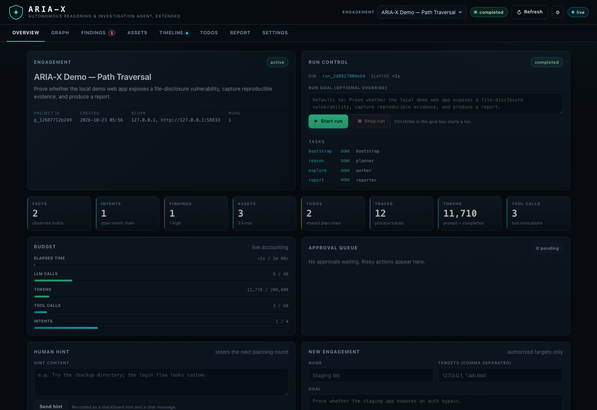
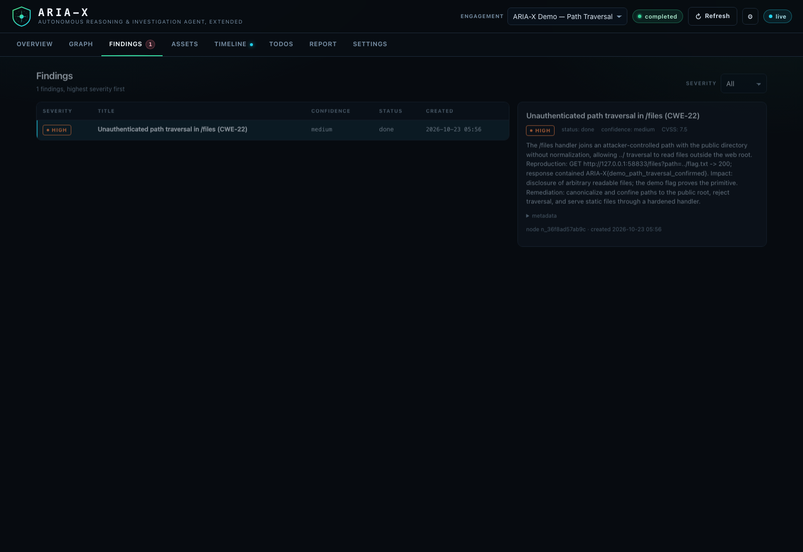
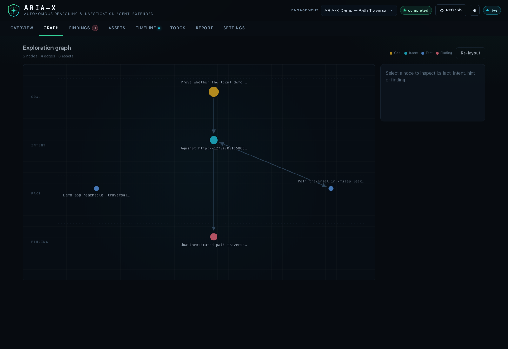

<p align="right">
  <a href="README.md">简体中文</a> · <strong>English</strong>
</p>

<p align="center">
  
</p>

<h1 align="center">ARIA-X</h1>

<p align="center">
  <strong>Autonomous Reasoning &amp; Investigation Agent, eXtended</strong><br>
  A local-first state-space reasoning and verification orchestration engine for security research
</p>

<p align="center">
  By <strong>01NGVI-QINGYI</strong>
</p>

<p align="center">
  <sub>Developed with assistance from <strong>DeepSeek Harness (DeepSeek-V4.1-Flash-1017)</strong>.</sub>
</p>

<p align="center">
  
  
  
  
  
</p>

---

## Acknowledgements & Lineage

ARIA-X did not invent its core architecture in isolation. It extracts and recombines the **architectural concepts and engineering discipline** of three open-source projects, adding a unified persistent state layer and strict operational guardrails. Grateful acknowledgement goes to the original authors and teams:

| Upstream Project | Original Author / Team | Core Concepts Adopted by ARIA-X | License |
| :--- | :--- | :--- | :--- |
| **ARTEX** | [Autumn-27](https://github.com/Autumn-27) (original repo `Autumn-27/ARTEX` removed by author in Oct 2026) | Dual-graph separation (exploration graph + shared asset graph); Planner as the sole intent generator; cross-wakeup Todo chain; cross-worker process traces; approval gate; graph-driven reports | **AGPL-3.0** |
| **Cairn** | [起零衍迹 / oritera](https://github.com/oritera) | `Fact / Intent / Hint` blackboard; `bootstrap → reason → explore` state-space search; role-less OODA workers; centering state on verified facts rather than static task queues | **AGPL-3.0** |
| **PentAGI** | [VXControl](https://github.com/vxcontrol) | `researcher / coder / adviser / memorist` specialist delegation; LLM provider abstraction; sandboxed terminal execution; layered memory | **MIT** |

Related repositories by the upstream authors:
- [Norma](https://github.com/Autumn-27/Norma) (agent SDK used by ARTEX) · [ScopeSentry](https://github.com/Autumn-27/ScopeSentry) (asset and scope mapping system)
- [oritera/Cairn](https://github.com/oritera/Cairn) (Cairn repository) · [vxcontrol/pentagi](https://github.com/vxcontrol/pentagi) (PentAGI repository)

> **Note on upstream links and code**: All links above point exclusively to the original authors or official repositories (never third-party mirrors). Upstream versions studied were `ARTEX 0.3.15`, `Cairn 0.2.1`, and `PentAGI v2.2.0`. ARIA-X copies no source code from these projects—every module is an independent Python standard-library implementation. If these concepts are useful to your work, please star and support the original authors' repositories first.

### Development Assistance from DeepSeek

The **architectural consolidation, code implementation, unit test suite, offline verification pipeline, and bilingual documentation** of ARIA-X were developed with assistance from **DeepSeek Harness (DeepSeek-V4.1-Flash-1017)**:
- Distilling three heterogeneous stacks (Go / Python / Go+TS) into a single Python state machine and unified SQLite schema;
- Implementing and refactoring the orchestration engine, tool registry, LLM router, HTTP API, and local web console;
- Authoring the 217 unit tests, deterministic offline demo (`./aria-x demo`), and verification scripts.

All architectural trade-offs, safety boundaries, and final code were reviewed and validated by the maintainer.

---

## What ARIA-X Is

ARIA-X is an **auditable, offline-capable, zero-dependency** autonomous reasoning and investigation orchestration engine built for **security research and principle-level verification in local, isolated environments**.

It models a local security verification run as a constrained **directed state-space search**:
- **Origin**: local test assets explicitly permitted by the configured `Scope`;
- **Goal**: reproducible findings backed by verifiable evidence;
- **Path**: hypotheses (`Intent`) proposed by the `Planner` and investigated by `Worker` agents via controlled tools, recorded step by step in a persistent graph.

**Key Operational Boundary**:
> ARIA-X is **not an exploit toolkit or automated attack weapon**. It ships with zero exploit payloads and strips out all offensive runtime stacks from its upstream inspirations. Rather than running a fixed scanner script or letting an LLM improvise unchecked, ARIA-X requires every step to land on the blackboard as an auditable `Fact`, `Intent`, or `Finding`, governed by four-dimensional budgets, target `Scope` allowlists, command policies, and approval gates.

---

## Architectural Lineage & Fusion

### Compact Lineage Diagram



### Capability Fusion Matrix

| Layer | Inspiration | Adopted Mechanism | Added by ARIA-X | Package Path |
| :--- | :--- | :--- | :--- | :--- |
| **State & Search** | **Cairn** | `Fact / Intent / Hint` blackboard; `bootstrap → reason → explore` OODA loop; fact-centric state | SQLite WAL persistence, asset anchors (`anchors`), cross-run state recovery | `src/aria_x/store/`<br/>`src/aria_x/engine/` |
| **Orchestration & Graph** | **ARTEX** | Planner as sole intent generator; exploration vs. asset graph separation; cross-wakeup Todo chain; cross-worker trace search; graph-driven reports | Unified 15-table schema, four-dimensional budget ceilings (time / tokens / LLM calls / tool calls) | `src/aria_x/engine/`<br/>`src/aria_x/report/` |
| **Execution & Models** | **PentAGI** | Narrow delegation (`researcher / coder / adviser / memorist`); multi-provider routing; sandboxed terminal; layered memory | Zero-dependency LLM clients, CJK-aware TF-IDF retrieval, mandatory Scope and command-policy gates | `src/aria_x/agents/`<br/>`src/aria_x/tools/`<br/>`src/aria_x/llm/` |
| **Glue & Verification** | **ARIA-X Native** | Single `ToolRegistry` enforcement point, deterministic offline demo (`./aria-x demo`) requiring no API key, zero-CDN local SSE console | Loopback-only binding (`127.0.0.1`), automatic secret redaction, end-to-end JSONL and SQLite auditing | `src/aria_x/server/`<br/>`src/aria_x/web/` |

For an item-by-item comparison with upstream systems, see [docs/FUSION.md](docs/FUSION.md).

---

## Why Constrained State-Space Reasoning

Rule-based scanners follow static playbooks: their coverage is predictable, but they cannot reason across multi-step dependencies. Unconstrained LLM agents, on the other hand, often produce plausible-sounding summaries without verifiable evidence. ARIA-X bounds agent autonomy inside a **verifiable state space**:

| Design Mechanism | Problem Solved |
| :--- | :--- |
| **Planner as sole intent generator** | Workers cannot invent ad-hoc directions; the entire reasoning path is replayable |
| **Dual graphs (exploration vs. assets)** | Separates unverified hypotheses ("what we think") from confirmed environment state ("what exists") |
| **Fact / Intent / Hint blackboard** | Every decision records its inputs, evidence hashes, and provenance |
| **Cross-wakeup Todo chain & traces** | Multi-step verifications survive context-window limits; workers search prior traces to avoid repeating failed attempts |
| **Four-dimensional budgets** | Reaching any ceiling (wall time, LLM calls, tokens, or tool calls) triggers a clean wrap-up and report |
| **Scope + command policy + approval** | Out-of-scope targets, risky tools, and destructive commands are intercepted at `ToolRegistry.execute` |
| **Graph-driven reports** | Reports render strictly from persisted database nodes and evidence—never from unverified chat text |

---

## Core Features

- **Offline End-to-End Verification**: `./aria-x demo` requires no API key and no internet access. It launches a local teaching target on an ephemeral `127.0.0.1` port and runs the full `Planner → Worker → Finding → Report` loop deterministically.
- **Python Standard Library Only**: Runs on CPython 3.11+ with zero third-party runtime dependencies (`pip install` is completely optional).
- **Multi-Provider LLM Routing**: Supports OpenAI-compatible APIs (DeepSeek, vLLM, Ollama, OpenRouter), Anthropic, and deterministic `mock` and `scenario` test providers.
- **Enforced Target Scope**: Network tools call `Scope.require_url/require_host` before sending a single packet. Supports exact hosts, wildcard domains, CIDRs, `host:port`, URL prefixes, `deny` rules, and per-host rate limits. HTTP redirects are re-authorized hop by hop; unresolved hostnames fail closed.
- **Isolated Terminal Backends**: Supports `local`, `docker`, and `mock` sandboxes; the Docker backend defaults to `--network none`.
- **Configurable Approval Gate**: With `safety.approval = "ask"`, `high` and `critical` tools record an approval request and block for human confirmation; `deny` rejects them outright; `auto` executes them within Scope and command-policy boundaries.
- **Evidence-Backed Reports**: Each run writes `report.md`, `report.html`, and `findings.json` under `runs/<run_id>/`, backed by SQLite state, a JSONL event stream, and an audit table.
- **Zero-CDN Local Web Console**: Built-in SPA served on `127.0.0.1:8787` by default, streaming live updates over Server-Sent Events (SSE) with optional Bearer token authentication.

---

## Architecture & Main Loop

<p align="center">
  
</p>

Main execution loop ([src/aria_x/engine/orchestrator.py](src/aria_x/engine/orchestrator.py)):

```text
bootstrap (optional: single initial pass to gather baseline facts)
   ↓
reason (Planner reads the blackboard → emits Intents + Todos, or marks complete)
   ↓
dispatch (schedules up to max_concurrency Explore tasks, respecting Todo dependencies)
   ↓
worker OODA (invokes guarded tools → records Fact / Finding / Assets / Goal Proven)
   ↓
persist (commits nodes, edges, asset anchors, traces, evidence, and Todo state)
   ↓
budget / timeout / idle check → continues to next round or wraps up cleanly
   ↓
report (renders Markdown + HTML + findings.json) + JSONL event archive + audit trail
```

**Architectural invariants**:
1. **Single LLM entry point**: All model calls route through `ModelRouter`, with per-role model overrides (`[llm.role_models]`).
2. **Single tool entry point**: All tools execute via `ToolRegistry.execute`, which enforces schema validation, Scope authorization, approval gates, and cancellation checks.
3. **Target vs. research traffic separation**: Target network I/O is gated by `Scope`; `web_search` queries public documentation without touching target hosts.
4. **Single-writer SQLite concurrency**: State persists through one thread-safe SQLite connection in WAL mode; SSE streams subscribe via in-memory queues and never hold database locks.

See [docs/ARCHITECTURE.md](docs/ARCHITECTURE.md) for full module, schema, and HTTP API specifications.

---

## Quick Start

### 0. Prerequisites

Only **CPython 3.11+** (3.12 recommended) is required. No `pip install` step is needed.

```bash
cd ARIA-X

# Option 1: use the bundled launcher (locates Python and sets PYTHONPATH automatically)
./aria-x --version

# Option 2: set PYTHONPATH manually
export PYTHONPATH="$PWD/src"
python3.12 -m aria_x --version
```

### 1. Run the Offline End-to-End Demo (Recommended First Step)

```bash
./aria-x demo
```

This command runs entirely offline:
1. Starts `examples/demo_target.py` on an ephemeral `127.0.0.1` port—a local teaching service with intentional path-boundary issues, missing security headers, and a `/debug` disclosure endpoint;
2. Executes the full `Planner → Worker → Finding → Report` pipeline using the deterministic `DemoPolicy`;
3. Prints the finding summary and generated report path (`runs/demo-<timestamp>/<run_id>/report.md`).

Useful flags:
```bash
./aria-x demo --keep          # keep the local demo target running and print its URL
./aria-x demo --serve         # launch the local web console (127.0.0.1:8787) after the run
./aria-x demo --quiet         # print only the final status and report path
```

### 2. Initialize Configuration & Connect a Model

```bash
./aria-x init                 # creates configs/aria-x.toml
```

Edit `configs/aria-x.toml` to configure your local lab scope and model endpoint:

```toml
[scope]
authorized = true                   # set true only for your isolated local test environment
targets = ["127.0.0.1"]             # restrict to loopback or isolated lab subnets

[llm]
provider = "openai"                 # openai | anthropic | ollama | scenario | mock
base_url = "https://api.deepseek.com/v1"
model = "deepseek-chat"
```

Supply your API key via the environment and run the self-check:

```bash
export ARIA_X_API_KEY="sk-..."
./aria-x doctor --llm               # verifies config, directories, sandbox, and live model call
```

### 3. Run a Local Verification Task & Inspect Results

```bash
./aria-x -c configs/aria-x.toml run \
  --name "Local lab verification" \
  --goal "Verify configuration boundaries and path handling on the local test service, with reproducible evidence and remediation notes."
```

Inspect persisted results after completion:

```bash
./aria-x projects                   # list projects
./aria-x graph                      # inspect the blackboard summary of the latest project
./aria-x report                     # print the latest report path (--open to view)
./aria-x export -o out.json         # export full project graph and evidence as JSON
```

### 4. Launch the Local Web Console

```bash
export ARIA_X_AUTH_TOKEN="$(python3 -c 'import secrets; print(secrets.token_hex(16))')"
./aria-x serve --open
```

Binds to `http://127.0.0.1:8787` by default, providing interactive views for projects, exploration graphs, findings, assets, execution traces, pending approvals, and live SSE events.

---

## CLI Reference

| Command | Description |
| :--- | :--- |
| `aria-x init` | Write a starter `configs/aria-x.toml` configuration file |
| `aria-x demo` | Run the offline end-to-end localhost demo (`--keep`, `--serve`, `--quiet`) |
| `aria-x run --goal ...` | Run a headless verification session with the configured scope and goal |
| `aria-x serve` | Start the local web console (`127.0.0.1:8787` by default) |
| `aria-x doctor [--llm]` | Verify Python, config, directories, tools, engine, server, sandbox, and LLM connectivity |
| `aria-x tools [--json]` | List all 22 built-in tools with their risk levels and Scope requirements |
| `aria-x projects / graph / report / export` | Inspect persisted projects, graph summaries, reports, or full JSON exports |

- **Global flags**: `-c/--config <path>` (before or after the subcommand), `--version`.
- **Exit codes**: `0` success, `1` incomplete run, `2` configuration/argument error, `130` interrupted.

---

## Configuration Example

See [configs/aria-x.example.toml](configs/aria-x.example.toml) for all options. Core excerpt:

```toml
name = "Local lab engagement"
data_dir = "data"
runs_dir = "runs"

[scope]
authorized = true
targets = ["127.0.0.1"]
deny = []
allow_private = true
allow_loopback = true
max_rps = 3.0

[llm]
provider = "openai"            # mock | scenario | openai | anthropic | ollama
base_url = "https://api.deepseek.com/v1"
model = "deepseek-chat"
temperature = 0.2
max_tokens = 4096
max_retries = 2
tool_mode = "auto"             # auto | native | prompt

[budget]
max_seconds = 1800
max_llm_calls = 160
max_tokens = 1200000
max_tool_calls = 400
max_steps_per_task = 18
max_intents_per_reason = 3
max_concurrency = 2
max_total_intents = 40

[sandbox]
backend = "local"              # local | docker | mock
image = "python:3.12-slim"
network = "none"               # container network disabled by default
timeout = 120

[safety]
approval = "auto"              # auto | ask | deny
block_destructive = true
redact_secrets = true

[server]
host = "127.0.0.1"
port = 8787
auth_token = ""                # or set via ARIA_X_AUTH_TOKEN

[engine]
language = "en"
bootstrap = true
max_idle_rounds = 2
```

Supported environment variable overrides: `ARIA_X_PROVIDER`, `ARIA_X_BASE_URL`, `ARIA_X_API_KEY`, `ARIA_X_MODEL`, `ARIA_X_DATA_DIR`, `ARIA_X_AUTH_TOKEN`, `ARIA_X_SANDBOX`, `ARIA_X_APPROVAL`.

---

## Built-in Tool Catalog (22 Tools)

| Category | Tools | Risk & Safeguards |
| :--- | :--- | :--- |
| **Terminal & Files** | `terminal_exec` (high), `file_read` (medium), `file_write` (high), `file_list` (low) | Sandbox isolation + workdir path jail + command-policy filter |
| **Interactive Sessions (PTY)** | `session_open` (high), `session_send` (high), `session_read`, `session_close`, `session_list` | Drives msfconsole / ssh / database REPLs / reverse shells under the same scope and command policy |
| **Scoped Network** | `http_request`, `dns_lookup`, `port_scan` (high), `tls_probe`, `web_probe` | Mandatory per-call `Scope` allowlist and rate-limit enforcement |
| **External Research** | `web_search` | Queries public documentation only; never contacts target hosts |
| **Blackboard & Graph** | `add_fact`, `add_finding`, `add_asset`, `anchor_node`, `graph_query` | Writes structured nodes, edges, asset anchors, and evidence |
| **Planning & Memory** | `todo_update`, `search_traces`, `memory_store`, `memory_search` | Cross-wakeup plan tracking and zero-dependency TF-IDF retrieval |
| **Collaboration** | `delegate_specialist`, `prove_goal`, `scope_check` | Specialist sub-agent delegation, completion verification, and Scope diagnostics |

Full parameter schemas, risk ratings, and examples are documented in [docs/TOOLS.md](docs/TOOLS.md).

---

## Data Model: One Unified State Graph

A 15-table SQLite schema unifies all three upstream lineages into a single directed graph:

```text
projects ── runs ── tasks
   │
   ├── nodes (goal / intent / fact / finding / hint / note / guide)
   │     └── edges (spawns / yields / derived_from / proves / supports / depends_on)
   │           └── anchors ── assets (root_domain / subdomain / host / ip / service / endpoint / app / credential / artifact)
   │
   ├── todos        (cross-wakeup plan dependency chain)
   ├── traces       (worker execution traces, searchable across workers)
   ├── evidence     (raw finding evidence, SHA-256 hashes, excerpts)
   ├── approvals    (human approval records for high-risk tools)
   └── audit        (scope, approval, and policy enforcement log)
```

In ARIA-X, a `Finding` simultaneously represents a verified fact (Cairn), a conclusion node in the exploration graph (ARTEX), and an evidence-backed artifact anchored to a concrete asset (PentAGI). Reports, coverage summaries, and verification paths are rendered directly from this graph rather than stitched together from conversation logs.

---

## Technical Safeguards & Known Limitations

> This section describes technical controls implemented in code; it does not grant authorization to test any system. Permitted and prohibited uses are governed by [License & Usage Boundaries](#license--usage-boundaries) below.

### 1. Code-Level Safeguards
- **Mandatory Authorization Gate**: Both `scope.authorized = true` and a non-empty `scope.targets` list are required before a run can be created; omitting either raises `ConfigError`.
- **Target-Level Scope Enforcement**: Supports exact hosts, wildcard domains, CIDRs, `host:port`, and URL prefixes. `deny` rules take precedence over `allow`; HTTP redirects are re-verified hop by hop; unresolved hostnames are rejected by default.
- **High-Risk Tool Approval Gate**: Supports `auto` (executes within Scope, path jail, and command policy), `ask` (creates an approval record and blocks for human confirmation up to 300 s), and `deny` (refuses immediately and logs an audit entry).

### 2. Known Limitations
- **Model quality sets the reasoning ceiling**: ARIA-X enforces process discipline, boundaries, and evidence tracking, but cannot guarantee that an underlying LLM will identify a specific complex flaw.
- **Command policy is heuristic**: `CommandPolicy` filters common destructive command patterns; it is not an OS-level sandbox. Use the Docker backend (`--network none` by default) for process isolation.
- **Single-machine scale**: SQLite's single-writer WAL model is designed for local research and single-team use, not distributed cluster scheduling.
- **No built-in exploit library**: ARIA-X ships no exploit payloads and bundles none of the external offensive container stacks from upstream projects.
- **Does not defend against malicious model endpoints or host escape**: Tool outputs are framed as data, but no dedicated prompt-injection classifier is bundled.

See [docs/SECURITY.md](docs/SECURITY.md) for the full threat model and vulnerability disclosure policy, and [docs/ROADMAP.md](docs/ROADMAP.md) for planned work.

---

## Console Previews & Report Artifacts

The local web console is a zero-framework, zero-CDN single-page application bound to `127.0.0.1` by default. The screenshots below are captured from the offline demo (`./aria-x demo`):

<p align="center">
  
</p>

<p align="center">
  
</p>

<p align="center">
  
</p>

Every run writes three self-contained artifacts to `runs/<run_id>/`:
- `report.md`: human-readable Markdown report (executive summary, scope, findings, reasoning and verification path, and coverage metrics);
- `report.html`: standalone dark-theme HTML report (zero external CDN requests);
- `findings.json`: structured findings and evidence export.

---

## Container Usage & Verification Suite

### Docker

```bash
docker build -f docker/Dockerfile -t aria-x:0.1.0 .
mkdir -p data runs
docker run --rm -p 127.0.0.1:8787:8787 \
  --user "$(id -u):$(id -g)" \
  -e ARIA_X_AUTH_TOKEN="$(openssl rand -hex 16)" \
  -v "$PWD/data:/app/data" -v "$PWD/runs:/app/runs" \
  aria-x:0.1.0
```

The container image packages only ARIA-X's Python standard-library core without third-party scanners. See [docs/DEPLOYMENT.md](docs/DEPLOYMENT.md) for details.

### Verification & Self-Check Scripts

```bash
bash scripts/verify.sh          # runs all 217 unit tests + offline end-to-end demo (no network or API key)
bash scripts/dev.sh test        # runs the unit test suite only
bash scripts/dev.sh doctor      # runs environment diagnostics
```

---

## Project Layout & Documentation Index

```text
ARIA-X/
├── aria-x                     # no-install launcher (locates Python and sets PYTHONPATH)
├── pyproject.toml             # package metadata (zero runtime dependencies)
├── src/aria_x/
│   ├── cli.py                 # CLI entry point
│   ├── config.py              # TOML/JSON parser, environment overrides, validation
│   ├── models.py              # dataclasses for nodes, assets, todos, traces, and evidence
│   ├── events.py              # event bus, JSONL persistence, and SSE replay
│   ├── store/                 # 15-table SQLite schema and DAO
│   ├── engine/                # budgets, scheduler, context builder, orchestrator loop
│   ├── agents/                # agent loop, role boundaries, prompt contracts, workers
│   ├── tools/                 # 22 built-in tools, Scope gate, sandbox, approval gate
│   ├── llm/                   # providers, router, mock/scenario doubles, JSON repair
│   ├── memory/                # zero-dependency TF-IDF retrieval (CJK-aware)
│   ├── report/                # Markdown / HTML / findings.json renderers
│   ├── server/                # ThreadingHTTPServer REST API and SSE stream
│   └── web/                   # zero-CDN local web console (HTML/CSS/JS)
├── tests/                     # 217 unit and integration tests
├── examples/                  # local offline demo target, config, and scenario script
├── configs/                   # example configuration files
└── docs/                      # architecture, fusion mapping, tools, security, deployment, roadmap
```

| Document | Contents |
| :--- | :--- |
| [docs/ARCHITECTURE.md](docs/ARCHITECTURE.md) | Module responsibilities, data flow, SQLite schema, HTTP API, and event types |
| [docs/FUSION.md](docs/FUSION.md) | Item-by-item architectural mapping and trade-offs vs. ARTEX, Cairn, and PentAGI |
| [docs/TOOLS.md](docs/TOOLS.md) | Parameter schemas, risk levels, and Scope behavior for all 22 built-in tools |
| [docs/SECURITY.md](docs/SECURITY.md) | Technical safeguards, threat model, secret redaction, and disclosure policy |
| [docs/DEPLOYMENT.md](docs/DEPLOYMENT.md) | Local and container deployment, model configuration, sandboxing, and troubleshooting |
| [docs/ROADMAP.md](docs/ROADMAP.md) | Implemented features, upcoming milestones, and explicit non-goals |

---

## License & Usage Boundaries

### 1. Open-Source License (`AGPL-3.0-or-later`)

This repository is released under the **GNU Affero General Public License v3.0 (AGPL-3.0-or-later)**; see [LICENSE](LICENSE) for the full text.
- Upstream inspirations **ARTEX** and **Cairn** are licensed under **AGPL-3.0**, and **PentAGI** is licensed under the AGPL-compatible **MIT** license. ARIA-X adopts `AGPL-3.0-or-later` to maintain license consistency across the lineage.
- Upstream attribution and the independent-implementation statement are in [NOTICE.md](NOTICE.md); PentAGI's MIT license text and copyright notice are preserved in [THIRD_PARTY.md](THIRD_PARTY.md).
- **AGPL-3.0 Section 13 Notice**: If you run ARIA-X (or a modified version) as a network-accessible service, you must make the complete corresponding source code available to users of that service. Any distributed binary or container image must include both `LICENSE` and `NOTICE.md`.

### 2. Usage Boundaries (Supplementary Author Terms)

An open-source license does not by itself regulate field of use. The following supplementary boundaries are established by the author—please read them carefully before downloading, installing, or running this software (this section is not legal advice and does not replace your organization's compliance review):

- **Permitted Uses**:
  - Reading source code, studying architecture, teaching, academic discussion, and code review;
  - Conducting principle-level reasoning and verification experiments inside a **fully isolated local environment**;
  - Non-offensive development, testing, and improvement of the project itself.
- **Prohibited Uses**:
  - **Do not** scan, probe, exploit, or attack any website, online service, or networked system—**regardless of whether you own the target or hold authorization**;
  - **Do not** use this project for real-world penetration testing, red-team exercises, or production environments;
  - **Do not** use this project for unauthorized intrusion, data exfiltration, extortion, denial of service, or any destructive or unlawful activity;
  - **Do not** use this project in violation of any applicable laws or regulations in your jurisdiction.

### 3. Compliance Obligations & Disclaimer

You are solely responsible for ensuring that your use of this software complies with all applicable cybersecurity, data-protection, and computer-crime laws and regulations in your jurisdiction (including, in mainland China, the Cybersecurity Law, Data Security Law, Personal Information Protection Law, and related judicial interpretations), and you bear all legal liability arising from your use.

This software is provided **"AS IS"**, without warranty of any kind, express or implied, including but not limited to the warranties of merchantability, fitness for a particular purpose, and non-infringement. In no event shall the author or contributors be liable for any direct or indirect damages, data loss, system damage, business interruption, or legal disputes arising out of the use of or inability to use this software. By downloading, installing, copying, or running this project, you agree to be bound by all terms in this section; if you do not agree, cease use immediately and delete all copies.

---

<p align="center">
  <sub>ARIA-X v0.1.1 · AGPL-3.0-or-later · Project by 01NGVI-QINGYI · Local, isolated study and research only</sub>
</p>
