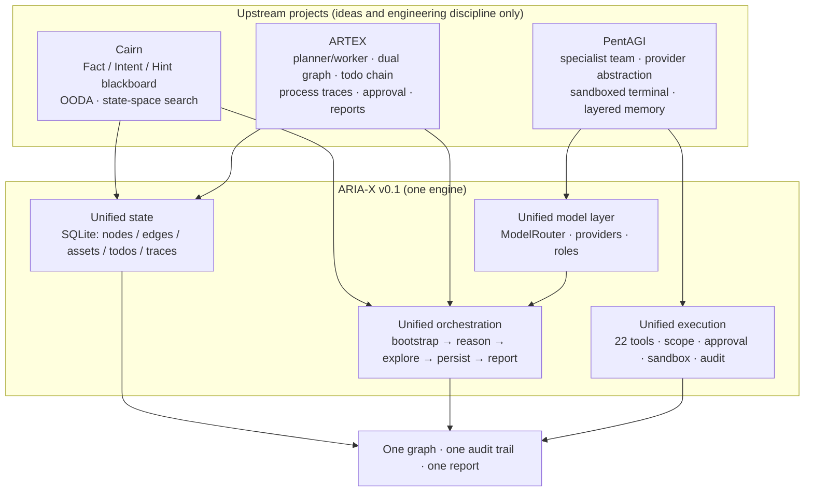

<p align="right">
  <a href="README.md">简体中文</a> · <strong>English</strong>
</p>

<p align="center">
  
</p>

<h1 align="center">ARIA-X</h1>

<p align="center">
  <strong>Autonomous Reasoning &amp; Investigation Agent, eXtended</strong><br>
  A local-first state-space reasoning engine for security research
</p>

<p align="center">
  By <strong>01NGVI-QINGYI</strong>
</p>

<p align="center">
  <sub>Developed with assistance from <strong>DeepSeek Harness (DeepSeek-V4.1-Flash-1017)</strong>.</sub>
</p>

<p align="center">
  
  
  
  
  
</p>

---

## Acknowledgements: standing on the shoulders of three open-source projects

ARIA-X did not invent its core ideas from scratch. It takes the **concepts and engineering
discipline** of three open-source systems, pulls them apart, recombines them, and adds the unified
state and safety layer they each lacked. Thank you to the original authors and teams for making
their work public:

| Project | Original author / team | Core ideas ARIA-X learned | License |
| --- | --- | --- | --- |
| **ARTEX** | [Autumn-27](https://github.com/Autumn-27) (original `Autumn-27/ARTEX`, deleted by the author in Oct 2026) | Dual graph (exploration + shared assets); planner as the sole intent generator; cross-wakeup todo chain; cross-worker process traces; approval gate; graph-driven reports | **AGPL-3.0** |
| **Cairn** | [起零衍迹 / oritera](https://github.com/oritera) | Fact / Intent / Hint blackboard; `bootstrap → reason → explore` state-space search; role-less OODA workers; facts first, not task lists | **AGPL-3.0** |
| **PentAGI** | [VXControl](https://github.com/vxcontrol) | researcher / coder / adviser / memorist specialists; provider abstraction; sandboxed terminal; layered memory; delegating complex work to narrow sub-agents | **MIT** |

Related projects by the same authors (also credited, for understanding the lineage):

- [Norma](https://github.com/Autumn-27/Norma) — the agent SDK used by ARTEX;
- [ScopeSentry](https://github.com/Autumn-27/ScopeSentry) — asset and scope mapping;
- [oritera/Cairn](https://github.com/oritera/Cairn) — the Cairn repository;
- [vxcontrol/pentagi](https://github.com/vxcontrol/pentagi) — the PentAGI repository.

> **A note on links**: every link above points to the **original author or original project**.
> The ARTEX repository was deleted by its author, so no official project link exists; this README
> does not credit the authors of any third-party mirror. The upstream versions studied were
> ARTEX 0.3.15, Cairn 0.2.1 and PentAGI v2.2.0.

### About DeepSeek

**This project was developed, optimized and refactored with assistance from
DeepSeek Harness (DeepSeek-V4.1-Flash-1017).** More precisely, the **architecture consolidation,
code refactoring, test coverage, documentation and bilingual copy** were produced with that
assistance.
DeepSeek was used to:

- abstract three heterogeneous stacks (Go / Python / Go+TS) into one Python state machine and
  data model;
- generate and refactor the engine, tools, LLM adapters, HTTP API and web console;
- add unit tests, the offline end-to-end demo and the verification script;
- write this README, the architecture notes, the fusion mapping and the security model.

Design decisions, safety boundaries and the final code were reviewed by the maintainer. DeepSeek
is an accelerator and refactoring tool here — not the author of the three upstream projects, and
it does not endorse them.

---

## What is ARIA-X

ARIA-X is an **auditable, offline-capable, zero-dependency** autonomous reasoning and investigation engine for local, isolated security research.
It models a local security exercise as a **directed search through a state space**:

- **Origin**: local test assets inside the configured scope;
- **Goal**: reproducible findings with evidence;
- **Path**: proposed by a planner, executed by workers, recorded as a graph — unknown, and
  therefore searched.

It does not run a fixed scanner playbook, and it does not let the model improvise freely. Every
exploration must land on the blackboard as a Fact, Intent or Finding, and is constrained by
budget, scope, approval and audit.

### One sentence

> It is not a launcher that switches between ARTEX, Cairn and PentAGI.
> It pulls their invariants apart and rewrites them into **one state model, one loop, one tool
> layer**.

---

## How the three projects relate to ARIA-X

### Lineage tree



### Capability fusion tree (who covers whose blind spots)

```text
ARIA-X
├── State and search ......................... from Cairn
│   ├── Fact / Intent / Hint blackboard
│   ├── bootstrap → reason → explore OODA loop
│   ├── facts first, not task-list first
│   └── added by ARIA-X: persistence, asset anchors, cross-run readability
│
├── Orchestration and graph .................. from ARTEX
│   ├── planner is the sole intent generator (workers cannot invent direction)
│   ├── exploration graph (how we think) + asset graph (what exists) kept apart
│   ├── cross-wakeup todo chain (long exploit chains survive context loss)
│   ├── cross-worker process-trace retrieval
│   ├── approval gate + graph-driven reports
│   └── added by ARIA-X: unified node table, SQLite, budget guardrails
│
├── Execution and models ..................... from PentAGI
│   ├── researcher / coder / adviser / memorist specialists
│   ├── provider abstraction (OpenAI-compatible / Anthropic / Ollama)
│   ├── local / docker / mock sandbox
│   ├── layered memory and narrow delegation
│   └── added by ARIA-X: enforced scope, command policy, enforced approval
│
└── New in ARIA-X ............................. the fusion glue
    ├── single ToolRegistry: validation + scope + approval + audit + traces
    ├── four-dimensional budgets: time / LLM calls / tokens / tool calls
    ├── single SQLite: projects / runs / nodes / edges / assets / todos / traces / evidence
    ├── zero-dependency TF-IDF memory (CJK-aware)
    ├── deterministic offline demo (no API key)
    └── local web console (SSE live events, graph, findings, report)
```

### Directory-level mapping

```text
ARIA-X/
├── src/aria_x/store/        ← new in ARIA-X: unified state (absorbs ARTEX dual graph + Cairn board)
├── src/aria_x/engine/       ← Cairn search loop + ARTEX planner/worker/todo/report
├── src/aria_x/agents/       ← ARTEX role boundaries + PentAGI specialist delegation
├── src/aria_x/tools/        ← ARTEX approval/asset tools + PentAGI sandbox/terminal
├── src/aria_x/llm/          ← PentAGI provider abstraction (rewritten, zero-dependency)
├── src/aria_x/memory/       ← PentAGI memory idea (rewritten as TF-IDF, no vector DB)
├── src/aria_x/server/       ← new in ARIA-X: HTTP API + SSE
├── src/aria_x/web/          ← new in ARIA-X: zero-CDN console
└── docs/FUSION.md         ← exactly what was borrowed and what was deliberately not
```

A detailed mapping is in [docs/FUSION.md](docs/FUSION.md).

---

## Why ARIA-X

Classic scanners follow a fixed playbook: predictable coverage, but no way to pursue an unknown
path. Pure LLM agents can look busy while leaving conclusions nobody can verify. ARIA-X constrains
autonomy inside a **verifiable state space**:

| Design | Problem it solves |
| --- | --- |
| Planner is the only intent generator | Workers cannot invent their own direction; the path can be replayed |
| Two graphs (exploration / assets) | "What we thought" never contaminates "what the target actually has" |
| Fact / Intent / Hint blackboard | Every decision has an input, evidence and provenance |
| Cross-wakeup todo chain | Long tasks do not repeat work or forget branches after context loss |
| Cross-worker process traces | Later workers can reuse earlier attempts instead of repeating them |
| Four-dimensional budget | Time / LLM calls / tokens / tool calls: any ceiling stops cleanly with a report |
| Scope + command policy + approval | Out-of-scope targets, destructive commands and risky actions have explicit gates |
| Graph-driven reports | Reports render only persisted facts/findings; the model cannot invent them |

---

## Core features

- **Offline verification**: `./aria-x demo` needs no API key and no network. It starts a real,
  intentionally vulnerable localhost target, runs a full engagement and produces a finding and a
  report.
- **Standard library only**: runtime needs CPython 3.11+ and nothing else. `pip` is optional.
- **Multiple model providers**: OpenAI-compatible endpoints (DeepSeek, vLLM, Ollama, OpenRouter,
  etc.), Anthropic, plus deterministic `mock` and `scenario` providers.
- **Enforced scope**: network tools call `Scope.require_url/require_host` before the first packet;
  exact hosts, wildcard domains, CIDRs, host:port, URL prefixes, deny rules and per-host rate
  limits are supported. Redirects are re-authorized hop by hop; unresolved hostnames fail closed.
- **Isolated terminal**: `local`, `docker` and `mock` sandboxes; Docker defaults to
  `--network none`.
- **Approval gate**: in `safety.approval="ask"`, `high` / `critical` tools create an approval
  record and block for a human decision; `deny` refuses them; `auto` allows them but scope and
  command policy still apply.
- **Evidence-backed reports**: each run writes `report.md`, `report.html` and `findings.json`
  under `runs/<run_id>/`, alongside SQLite state, a JSONL event stream and the audit table.
- **Web console**: local HTTP API + SSE (bound to `127.0.0.1` by default, optional Bearer token).
- **Recoverable engineering**: SQLite (WAL) persists projects, runs, nodes, edges, assets, todos,
  tasks, traces, evidence, approvals and audit.

---

## Architecture

<p align="center">
  
</p>

The main loop of an engagement ([src/aria_x/engine/orchestrator.py](src/aria_x/engine/orchestrator.py)):

```text
bootstrap (optional, one best-effort attempt)
   ↓
reason (planner reads the board → intents + todos, or complete)
   ↓
dispatch (up to max_concurrency explore tasks, respecting todo dependencies)
   ↓
worker OODA (tool calls → fact / finding / assets / goal_proven)
   ↓
persist (nodes + edges + asset anchors + traces + evidence + todo state)
   ↓
budget / time / idle / change detection → next round or wrap-up
   ↓
report (Markdown + HTML + findings.json) + JSONL events + audit
```

Key boundaries:

- **Models are reached only through `ModelRouter`**; role-to-model mapping is configurable
  (`[llm.role_models]`).
- **Tools run only through `ToolRegistry.execute`**, which applies argument validation, scope,
  approval and cancellation checks.
- **All target network I/O goes through `Scope` first**; `web_search` is external research
  traffic, not target traffic.
- **There is exactly one SQLite connection** (thread-safe, WAL); SSE never holds the SQLite lock.

Modules, data model and HTTP API are documented in [docs/ARCHITECTURE.md](docs/ARCHITECTURE.md).

---

## Quick start

### 0. Requirements

Only **CPython 3.11+** (3.12 recommended). No `pip install` is required.

```bash
# Copy/extract the ARIA-X directory anywhere on your machine
cd ARIA-X

# Option 1: bundled launcher (finds Python and sets PYTHONPATH)
./aria-x --version

# Option 2: set PYTHONPATH manually
export PYTHONPATH="$PWD/src"
python3.12 -m aria_x --version
```

### 1. Offline end-to-end demo (recommended first command)

```bash
./aria-x demo
```

It will:

1. start `examples/demo_target.py` on a random `127.0.0.1` port — a safe, intentionally
   vulnerable local target with path traversal, missing security headers and a `/debug` leak;
2. drive the full planner → worker → finding → report path with the deterministic `DemoPolicy`;
3. print the finding count and report path (`runs/demo-<timestamp>/<run_id>/report.md`).

Useful variants:

```bash
./aria-x demo --keep          # keep the target running and print its URL
./aria-x demo --serve         # open the web console (:8787) afterwards
./aria-x demo --quiet         # only print the final status and report path
```

### 2. Create a real configuration

```bash
./aria-x init                 # writes configs/aria-x.toml
$EDITOR configs/aria-x.toml
```

At minimum, edit:

```toml
[scope]
authorized = true                   # set true only after written authorization
targets = ["127.0.0.1"]             # host / *.example.test / 10.0.0.0/24 / URL prefix

[llm]
provider = "openai"                 # also anthropic / ollama / scenario / mock
base_url = "https://api.deepseek.com/v1"
model = "deepseek-chat"
# api_key is better supplied via the environment:
```

```bash
export ARIA_X_API_KEY="sk-..."
./aria-x doctor --llm                 # validate config and make one real model call
```

### 3. Run an engagement

```bash
./aria-x -c configs/aria-x.toml run \
  --name "Staging review" \
  --goal "Assess the web attack surface of staging.example.test, confirm reproducible high-severity issues and propose fixes."
```

Inspect the results:

```bash
./aria-x projects             # project list
./aria-x graph                # blackboard summary of the latest project
./aria-x report               # latest report path (--open to launch)
./aria-x export -o out.json   # full JSON export
```

### 4. Web console

```bash
export ARIA_X_AUTH_TOKEN="$(python3 -c 'import secrets; print(secrets.token_hex(16))')"
./aria-x serve --open
```

Default address: `http://127.0.0.1:8787`. The console shows projects, graph, findings, assets,
timeline, approvals, live SSE events and reports. The API is documented in
[docs/ARCHITECTURE.md](docs/ARCHITECTURE.md).

---

## CLI

| Command | Purpose |
| --- | --- |
| `aria-x init` | Write a starter `configs/aria-x.toml` |
| `aria-x demo` | Offline end-to-end demo (`--keep` keeps the target, `--serve` opens the console) |
| `aria-x run --goal ...` | Run one engagement headlessly |
| `aria-x serve` | Start the web console (`127.0.0.1:8787` by default) |
| `aria-x doctor [--llm]` | Check Python, config, directories, tools, engine, server, sandbox and model connectivity |
| `aria-x tools [--json]` | List the tool catalog (name, risk, scope requirement) |
| `aria-x projects` / `aria-x graph` / `aria-x report` / `aria-x export` | Inspect persisted results |
| `./aria-x ...` | No-install launcher: same as `PYTHONPATH=src python -m aria_x ...` |

Global flags: `-c/--config <path>` and `--version`. `-c` may appear before or after the
subcommand. Exit codes: `0` success, `1` run incomplete, `2` config/argument error, `130`
interrupted.

---

## Configuration

See [configs/aria-x.example.toml](configs/aria-x.example.toml) for the full example. Core excerpt:

```toml
name = "Staging engagement"
data_dir = "data"
runs_dir = "runs"

[scope]
authorized = true
targets = ["127.0.0.1", "*.staging.example.test", "10.10.0.0/24"]
deny = []
allow_private = true
allow_loopback = true
max_rps = 3.0

[llm]
provider = "openai"            # mock | scenario | openai | anthropic | ollama
base_url = "https://api.deepseek.com/v1"
model = "deepseek-chat"
temperature = 0.2
max_tokens = 4096
max_retries = 2
tool_mode = "auto"             # auto | native | prompt

[budget]
max_seconds = 1800
max_llm_calls = 160
max_tokens = 1200000
max_tool_calls = 400
max_steps_per_task = 18
max_intents_per_reason = 3
max_concurrency = 2
max_total_intents = 40

[sandbox]
backend = "local"              # local | docker | mock
image = "kalilinux/kali-rolling"
network = "none"               # use "bridge" only in an isolated lab
timeout = 120

[safety]
approval = "auto"              # auto | ask | deny
block_destructive = true
redact_secrets = true

[server]
host = "127.0.0.1"
port = 8787
auth_token = ""                # or ARIA_X_AUTH_TOKEN

[engine]
language = "en"
bootstrap = true
max_idle_rounds = 2
```

Environment variables: `ARIA_X_PROVIDER`, `ARIA_X_BASE_URL`, `ARIA_X_API_KEY`, `ARIA_X_MODEL`,
`ARIA_X_DATA_DIR`, `ARIA_X_AUTH_TOKEN`, `ARIA_X_SANDBOX`, `ARIA_X_APPROVAL`.

---

## Tools (22)

| Category | Tools | Risk |
| --- | --- | --- |
| Terminal / files | `terminal_exec` (high), `file_read` (medium), `file_write` (high), `file_list` (low) | Sandbox + path jail |
| Network (scope) | `http_request`, `dns_lookup`, `port_scan` (high), `tls_probe`, `web_probe` | Per-call scope authorization |
| External research | `web_search` | Does not touch the target |
| Blackboard | `add_fact`, `add_finding`, `add_asset`, `anchor_node`, `graph_query` | Graph writes |
| Planning / memory | `todo_update`, `search_traces`, `memory_store`, `memory_search` | State maintenance |
| Collaboration | `delegate_specialist`, `prove_goal`, `scope_check` | Low risk |

Full parameters, risk and examples: [docs/TOOLS.md](docs/TOOLS.md).

---

## Data model: one graph, not three logs

The unified SQLite schema (15 tables) carries all three lineages:

```text
projects ── runs ── tasks
   │
   ├── nodes (goal / intent / fact / finding / hint / note / guide)
   │     └── edges (spawns / yields / derived_from / proves / supports / depends_on)
   │           └── anchors ── assets (root_domain / subdomain / host / ip / service / endpoint / app / credential / artifact)
   │
   ├── todos        (cross-wakeup plan chain)
   ├── traces       (worker process records, searchable across workers)
   ├── evidence     (finding evidence, hashes, excerpts)
   ├── approvals    (human approval for high-risk tools)
   └── audit        (scope / approval / policy decisions)
```

A finding is simultaneously a Cairn-style confirmed fact, an ARTEX-style vulnerability node,
and — through anchors — a PentAGI-style artifact of specialist execution. Reports, coverage and
attack paths render from this graph rather than from chat logs.

---

## Security model

> This section documents technical safeguards in the code; it does not grant permission to use
> the project. The permitted and prohibited uses are defined by
> [License and disclaimer](#license-and-disclaimer) at the end of this document.

### Authorization gate

```toml
[scope]
authorized = true
targets = ["127.0.0.1"]
```

Missing either value raises `ConfigError` before a run is created. A project scope with
`authorized=false` is rejected as well.

### Target-level scope

- Exact hosts, wildcard domains, CIDRs, host:port and URL prefixes;
- `deny` wins over allow;
- `allow_private` / `allow_loopback` gate private and loopback ranges;
- per-host rate limiting; HTTP redirects re-checked hop by hop; unresolved hostnames denied.

### Approval for high-risk tools

| Mode | Behavior |
| --- | --- |
| `auto` (default) | Execute, still constrained by scope, workdir jail and command policy |
| `ask` | Create an approval record + `approval.requested` event, block for a human (up to 300 s) |
| `deny` | Refuse immediately and write an audit record |

### What it does not defend against

- A malicious or compromised model service;
- Prompt injection from targets (tool output is treated as data, but there is no dedicated
  classifier);
- Host or physical-layer escape;
- Indirect addressing inside `terminal_exec` (literal URLs/IPs are only heuristically checked;
  the real boundary is the Docker sandbox).

Full threat model and disclosure process: [docs/SECURITY.md](docs/SECURITY.md).

---

## Console

The console is a zero-framework, zero-CDN local SPA bound to `127.0.0.1` by default. Screenshots
below come from the real offline demo:

<p align="center">
  
</p>

<p align="center">
  
</p>

<p align="center">
  
</p>

More screenshots (assets, timeline, report, TODO) are in [assets/](assets/).

---

## Report artifacts

Every run writes to `runs/<run_id>/`:

```text
report.md        # human-readable Markdown (summary, scope, findings, attack path, coverage)
report.html      # self-contained dark HTML (no CDN)
findings.json    # structured findings export
```

Alongside:

- `data/aria-x.db`: SQLite state (projects, nodes, edges, assets, todos, tasks, traces, evidence,
  approvals, audit);
- `data/events.jsonl`: append-only event stream (SSE replay source for `aria-x serve`);
- `data/<project_id>-export.json`: full export from `aria-x export`.

---

## Docker

```bash
docker build -f docker/Dockerfile -t aria-x:0.1.0 .
mkdir -p data runs
docker run --rm -p 127.0.0.1:8787:8787 \
  --user "$(id -u):$(id -g)" \
  -e ARIA_X_AUTH_TOKEN="$(openssl rand -hex 16)" \
  -v "$PWD/data:/app/data" -v "$PWD/runs:/app/runs" \
  aria-x:0.1.0
```

Or:

```bash
export ARIA_X_AUTH_TOKEN="$(openssl rand -hex 16)"
export ARIA_X_API_KEY="sk-..."
export ARIA_X_UID="$(id -u)" ARIA_X_GID="$(id -g)"
docker compose -f docker/docker-compose.yml up --build
```

The image contains ARIA-X itself (standard library only), not scanning tools. Kali tooling and the
Docker sandbox are documented in [docs/DEPLOYMENT.md](docs/DEPLOYMENT.md) and
[docker/kali-sandbox.md](docker/kali-sandbox.md).

---

## Testing and self-checks

```bash
bash scripts/verify.sh          # unit tests + offline end-to-end demo (no network, no API key)
bash scripts/dev.sh test        # unit tests only
bash scripts/dev.sh doctor      # environment self-check
```

Current status: **202 tests**, passing on Python 3.11.14 and 3.12.12; `verify.sh` exits 0.

`scripts/verify.sh` discovers Python in this order: `$ARIA_X_PYTHON` → `python3.12` → `python3.11` → any `python3` ≥3.11.
It never runs `pip install`.

---

## Project layout

```text
ARIA-X/
├── aria-x                       # no-install launcher
├── pyproject.toml             # optional install (no runtime dependencies)
├── src/aria_x/
│   ├── cli.py                 # command line entry point
│   ├── config.py              # TOML/JSON config, env vars, validation
│   ├── models.py              # nodes / assets / todos / traces / evidence
│   ├── events.py              # event bus, JSONL persistence, SSE replay
│   ├── store/                 # SQLite schema and DAO
│   ├── engine/                # budget, scheduler, context, orchestrator, engagement
│   ├── agents/                # agent loop, roles, prompts, workers
│   ├── tools/                 # 22 tools, scope, sandbox, approval gate
│   ├── llm/                   # providers, router, mock, scenario, JSON repair
│   ├── memory/                # zero-dependency TF-IDF retrieval (CJK-aware)
│   ├── report/                # Markdown / HTML / findings.json
│   ├── server/                # ThreadingHTTPServer API + SSE
│   └── web/                   # zero-CDN console (HTML/CSS/JS)
├── tests/                     # 202 unit/integration tests
├── examples/                  # local vulnerable target, demo config, scenario
├── configs/                   # example configuration
├── docs/                      # architecture, fusion, tools, security, deployment, roadmap
├── docker/                    # Dockerfile, compose, Kali sandbox notes
├── scripts/                   # bootstrap / dev / verify
├── assets/                    # logo, architecture, console screenshots
├── .github/                   # CI and issue/PR templates
├── CONTRIBUTING.md            # contribution guide
├── CODE_OF_CONDUCT.md         # code of conduct
├── SECURITY.md                # security disclosure
├── CITATION.cff               # citation metadata
├── LICENSE                    # AGPL-3.0
├── NOTICE.md                  # upstream attribution
└── THIRD_PARTY.md             # MIT text and third-party notices
```

---

## Known limitations (honest list)

- **LLM quality sets the ceiling**: ARIA-X constrains process and evidence, not whether a model can
  find a specific vulnerability.
- **Command policy is heuristic**: `CommandPolicy` blocks common destructive patterns; it is not
  a full sandbox. The real isolation boundary is the Docker backend.
- **The Docker sandbox is not the scope boundary**: target authorization is enforced by `Scope`
  in the tool layer.
- **Single-machine scale**: SQLite's single-writer model suits one machine and one team; there is
  no distributed scheduler.
- **Reports are Markdown/HTML/JSON only**: no PDF export yet.
- **No built-in exploit library**: ARIA-X reasons, calls tools and records evidence; concrete
  exploits come from the model and remain bound by scope, command policy and approval.
- **`scenario` is a test double**: it replays a JSON script; it is not evidence of model ability.
- **Upstream runtimes are not embedded**: ARTEX's norma/Kali/MITM proxy, Cairn's Claude Code/Codex
  worker containers, and PentAGI's Graphiti/Neo4j/pgvector and Kali MCP stack are not bundled;
  ARIA-X rewrites the core loop.

Roadmap: [docs/ROADMAP.md](docs/ROADMAP.md).

---

## License

ARIA-X is released under the **GNU Affero General Public License v3.0
(AGPL-3.0-or-later)**. The full text is in [LICENSE](LICENSE).

Why AGPL-3.0:

- **ARTEX** and **Cairn** are both **AGPL-3.0**; ARIA-X keeps the same license;
- **PentAGI** is **MIT**; MIT is compatible with AGPL-3.0 and can be incorporated into an AGPL
  project;
- ARIA-X reimplements concepts rather than copying code, but choosing AGPL-3.0-or-later covers any
  future code-level reuse and stays consistent with the two AGPL upstreams.

Upstream attribution and the "no code copied" statement are in [NOTICE.md](NOTICE.md); PentAGI's
MIT text and copyright notice are reproduced in [THIRD_PARTY.md](THIRD_PARTY.md).

> **AGPL-3.0 §13**: if you provide ARIA-X as a network service, you must offer users the
> corresponding source code (for example, a reachable Source link in the console or service
> page). Distributing a binary or container image requires shipping `LICENSE` and `NOTICE.md`.

---

## Documentation

| Document | Contents |
| --- | --- |
| [docs/ARCHITECTURE.md](docs/ARCHITECTURE.md) | Modules, data flow, data model, HTTP API, events |
| [docs/FUSION.md](docs/FUSION.md) | Item-by-item mapping and trade-offs vs ARTEX / Cairn / PentAGI |
| [docs/TOOLS.md](docs/TOOLS.md) | Parameters, risk and scope behavior of all 22 tools |
| [docs/SECURITY.md](docs/SECURITY.md) | Technical safeguards, threat model, secrets, disclosure |
| [docs/DEPLOYMENT.md](docs/DEPLOYMENT.md) | Local/container deployment, model setup, sandbox, troubleshooting |
| [docs/ROADMAP.md](docs/ROADMAP.md) | Implemented / next / deliberately not doing |
| [CHANGELOG.md](CHANGELOG.md) | v0.1.0 change log |
| [docs/CONTRACTS.md](docs/CONTRACTS.md) | Internal build contracts (development reference) |
| [docs/GITHUB.md](docs/GITHUB.md) | GitHub About, topics and release checklist |

---

## Thanks again

- Thanks to [Autumn-27](https://github.com/Autumn-27) for **ARTEX**: the dual graph,
  planner/worker split, todo chain and process traces are the most important reference for ARIA-X's
  orchestration layer.
- Thanks to [起零衍迹 / oritera](https://github.com/oritera) for **Cairn**: the Fact / Intent /
  Hint blackboard and OODA search gave ARIA-X a state space instead of a task queue.
- Thanks to [VXControl](https://github.com/vxcontrol) for **PentAGI**: specialist roles, provider
  abstraction, sandboxing and memory made ARIA-X's execution layer strong.

If these projects help you, please star, file issues or contribute to the **original authors'
repositories** first.

---

## License and disclaimer

### Open-source license

The release license for this repository is the **GNU Affero General Public License v3.0
(AGPL-3.0)**; the full terms are in [LICENSE](LICENSE). The license allows use, modification and
redistribution, but derivative works must also adopt AGPL-3.0. If a modified version is offered as
a network service, the people using that service must be able to obtain the corresponding
complete source code.

### Usage boundaries (supplementary terms)

An open-source license does not by itself restrict what software may be used for. The following
are supplementary terms set by the authors; please read them before downloading, installing or
running the project. This section is not legal advice and does not replace your organisation's
compliance review.

**You may**

- Reading, studying, teaching, academic discussion and code review;
- Principle-level experiments in a fully isolated local environment;
- Non-offensive development, testing and improvement of the project itself.

**You must not**

- Scanning, probing, exploiting or attacking any website, online service or networked system —
  whether or not you own the target and whether or not you have authorization;
- Real-world penetration testing, red-team exercises or production systems;
- Illegal intrusion, data theft, extortion, denial of service, or any destructive or criminal
  activity;
- Any use that violates the laws or regulations of your jurisdiction.

### Your compliance obligations

You are responsible for complying with the cybersecurity, data-protection and computer-crime laws
that apply to you (for example, in mainland China, the Cybersecurity Law, Data Security Law,
Personal Information Protection Law and related judicial interpretations). You bear all legal
responsibility and consequences arising from your use of this project.

### Disclaimer

The project is provided as-is, based on the code and documentation available at the time of
download; no promise is made regarding merchantability, fitness for a particular purpose or
non-infringement. The authors and contributors accept no liability for any direct or indirect
loss, data loss, system damage, business interruption or legal dispute arising from the use or
inability to use this project. By downloading, installing, copying or running it, you accept this
entire section; if you do not agree, stop immediately and delete all copies.

---

<p align="center">
  <sub>ARIA-X v0.1.0 · AGPL-3.0-or-later · Project by 01NGVI-QINGYI · local, isolated study and research only</sub>
</p>
