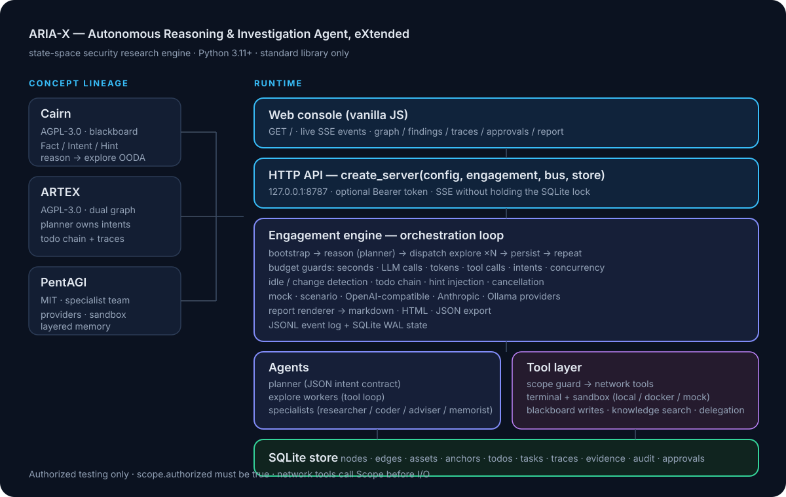
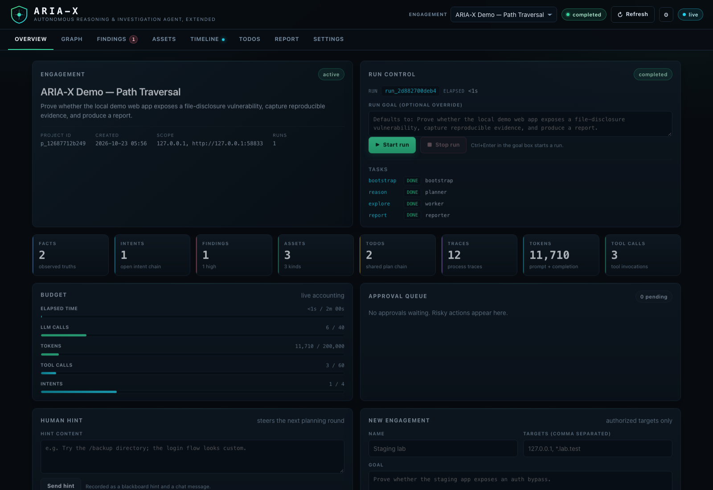
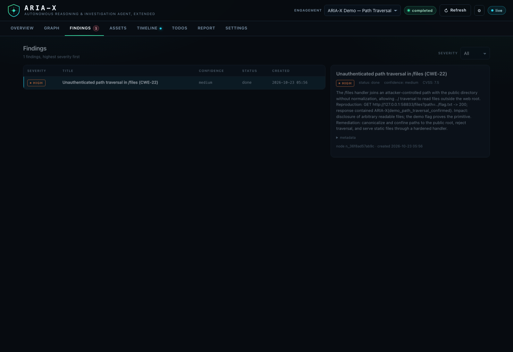
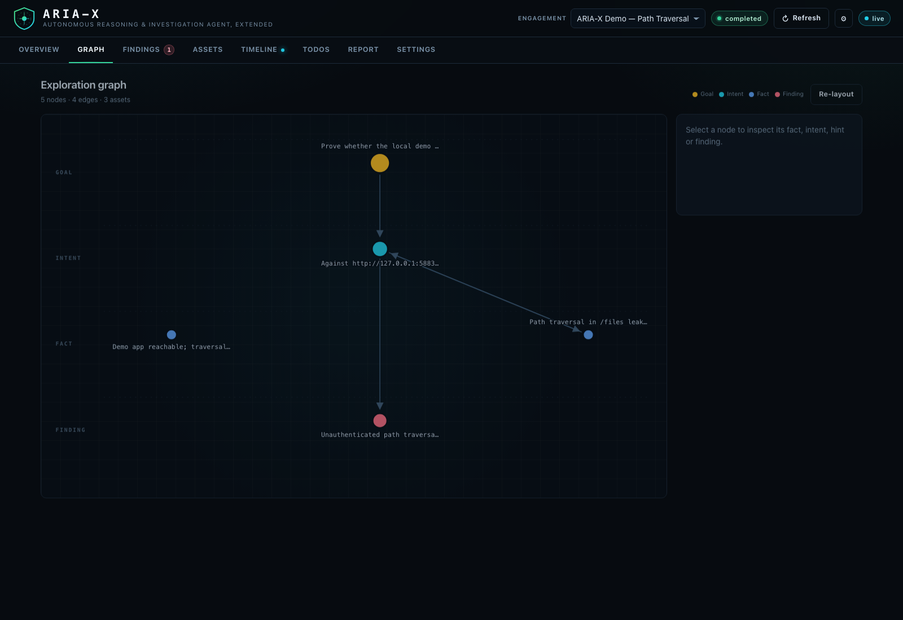

<p align="right">
  <a href="README.md">简体中文</a> · <a href="README.en.md">English</a> · <strong>日本語</strong>
</p>

<p align="center">
  
</p>

<h1 align="center">ARIA-X</h1>

<p align="center">
  <strong>Autonomous Reasoning &amp; Investigation Agent, eXtended</strong><br>
  ローカル・隔離環境でのセキュリティ研究に向けた状態空間推論・検証オーケストレーションエンジン
</p>

<p align="center">
  By <strong>01NGVI-QINGYI</strong><br>
  <sub>DeepSeek Harness（DeepSeek-V4.1-Flash-1017）の支援を受けて開発</sub>
</p>

<p align="center">
  
  
  
  
</p>

---

## 概要

**ARIA-X** は、ローカル環境やネットワークから隔離された実験環境でのセキュリティ研究・原理検証を目的とした、監査可能な状態空間推論エンジンです。実行時は **CPython 3.11 以上の標準ライブラリのみ**を使用し、サードパーティ製 Python パッケージを必要としません。

ARIA-X は次の三つのプロジェクトから**設計思想を参考にし、独立して実装**されています。元のソースコードをそのまま統合したものではありません。

| 参考プロジェクト | 参考にした設計思想 | ライセンス |
| :--- | :--- | :--- |
| **[ARTEX](https://github.com/Autumn-27)**（Autumn-27、元のリポジトリは削除済み） | 探索グラフと資産グラフの分離、Planner による Intent 生成、Todo チェーン、実行トレース、承認ゲート | AGPL-3.0 |
| **[Cairn](https://github.com/oritera/Cairn)**（oritera） | `Fact / Intent / Hint` のブラックボード、OODA ループ、状態空間探索 | AGPL-3.0 |
| **[PentAGI](https://github.com/vxcontrol/pentagi)**（VXControl） | 専門エージェントの役割分担、LLM Provider 抽象化、サンドボックス、記憶検索 | MIT |

詳細な出典と設計上の相違点は [NOTICE.md](NOTICE.md)、[THIRD_PARTY.md](THIRD_PARTY.md)、[docs/FUSION.md](docs/FUSION.md) を参照してください。

## 主な機能（v0.1.1）

- **双方向グラフによる状態管理**：探索ノード・エッジと資産・アンカーを SQLite に保存し、事実・仮説・発見事項を追跡します。
- **制約付きの自律実行**：`bootstrap → reason → dispatch → explore → persist → report` の処理を、時間・モデル呼び出し・トークン・ツール呼び出しなどの予算と空転検出で制御します。
- **複数の役割**：Planner、Bootstrap、Worker、Reporter と、`researcher` / `coder` / `adviser` / `memorist` の専門エージェントを分離します。
- **27 種類の内蔵ツール**：ファイル・ターミナル操作、HTTP/DNS/TCP/TLS 検証、ブラックボード・資産管理、検索、専門エージェントへの委任、目標検証などを提供します。
- **対話型 PTY セッション（v0.1.1 で追加）**：`session_open`、`session_send`、`session_read`、`session_close`、`session_list` により、対話が必要なターミナルプログラムを隔離されたローカル実験環境で扱えます。セッションの開始と入力送信は高リスク操作であり、Scope・コマンドポリシー・承認ゲートの対象です。同時セッション数は実行ごとに最大 4 件で、アイドル時の清掃処理も備えます。
- **安全上の制御**：対象 Scope のホワイトリスト、作業ディレクトリの制限、`local` / `docker` / `mock` サンドボックス、および `auto` / `ask` / `deny` の承認ポリシーを備えます。
- **ローカル Web コンソール**：標準では `127.0.0.1:8787` にバインドし、外部 CDN に依存せず、SSE による更新、グラフ、検出結果、実行履歴、承認待ち項目を表示します。
- **複数 LLM Provider**：OpenAI 互換 API、Anthropic、Ollama、Mock、Scenario に対応します。
- **監査可能な成果物**：SQLite、JSONL イベント・監査記録に加えて、`report.md`、`report.html`、`findings.json` を出力します。

## アーキテクチャ

<p align="center">
  
</p>

```text
Bootstrap → Reason (Planner) → Dispatch → Explore (Workers)
                   ↑                          ↓
               次の探索 ← Persist (SQLite / audit)
                                             ↓
                                  Report (MD / HTML / JSON)
```

ツール実行は ToolRegistry に集約され、対象範囲の確認、リスクに応じた承認、監査が行われます。詳しくは [アーキテクチャ](docs/ARCHITECTURE.md) と [安全モデル](docs/SECURITY.md) を参照してください。

## クイックスタート

**必要環境**：CPython 3.11 以上。通常のローカル実行では `pip install` は不要です。Docker サンドボックスを使用する場合のみ、別途コンテナ実行環境が必要です。

```bash
git clone https://github.com/01NGVI-QINGYI/ARIA-X.git
cd ARIA-X

# バージョン確認
./aria-x --version

# API キー不要・ネットワーク接続不要のローカルデモ
./aria-x demo

# 環境とテストの確認
bash scripts/verify.sh
```

`./aria-x demo` は `127.0.0.1` の一時ポートで教育用の模擬ターゲットを起動し、決定論的なデモポリシーで検証からレポート生成まで実行します。

```bash
./aria-x demo --serve     # デモ終了後にローカルコンソールを起動
./aria-x demo --quiet     # 最終結果を簡潔に表示
./aria-x init             # configs/aria-x.toml を生成
./aria-x doctor           # ローカル環境を診断
./aria-x tools            # 内蔵ツール一覧
```

実験設定を変更する場合は、`configs/aria-x.toml` で対象とモデルを明示してください。**`scope.authorized = true` と空でない `scope.targets` が必須**です。これらは技術的な起動条件であり、第三者システムのテストを許可するものではありません。

```toml
[scope]
authorized = true
targets = ["127.0.0.1"]

[llm]
provider = "openai"
model = "deepseek-chat"
base_url = "https://api.deepseek.com/v1"
```

```bash
export ARIA_X_API_KEY="your-api-key"
./aria-x doctor --llm

# 設定済みのローカル実験対象でのみ実行
./aria-x -c configs/aria-x.toml run --goal "ローカル実験環境の設定を検証し、証拠と報告を作成する"

./aria-x projects
./aria-x graph
./aria-x report
./aria-x export -o out.json

# Web コンソール
export ARIA_X_AUTH_TOKEN="$(python3 -c 'import secrets; print(secrets.token_hex(16))')"
./aria-x serve --open
```

## コンソールの画面

<p align="center">
  
</p>

<p align="center">
  
</p>

<p align="center">
  
</p>

## セキュリティと既知の制約

ARIA-X は**攻撃ペイロード集や完成された侵入テスト製品ではありません**。コマンドフィルターはヒューリスティックであり、完全な OS レベルの隔離を保証しません。モデルの推論結果が常に正確であることも保証されません。Docker バックエンドは通常ネットワークを無効化するため、必要な実験環境との接続は個別に設計する必要があります。クラッシュ後に中断した実行をそのまま再開する機能は、現行版では未実装です。

**利用対象は、ローカルの完全に隔離された実験環境における学習・研究・原理検証に限られます。** オンラインサービスやネットワークシステムのスキャン・侵入テストなどには、所有・許可の有無にかかわらず使用しないでください。詳細は [README.en.md の利用条件](README.en.md#license--usage-boundaries) と [docs/SECURITY.md](docs/SECURITY.md) を確認してください。

## ドキュメント

| 文書 | 内容 |
| :--- | :--- |
| [docs/ARCHITECTURE.md](docs/ARCHITECTURE.md) | 構成、状態モデル、API |
| [docs/FUSION.md](docs/FUSION.md) | 参考プロジェクトとの対応関係 |
| [docs/TOOLS.md](docs/TOOLS.md) | 27 ツールの仕様とリスク |
| [docs/SECURITY.md](docs/SECURITY.md) | 技術的な安全制御と制限 |
| [docs/DEPLOYMENT.md](docs/DEPLOYMENT.md) | 導入と実行環境 |
| [docs/ROADMAP.md](docs/ROADMAP.md) | 実装済み機能と今後の予定 |
| [CHANGELOG.md](CHANGELOG.md) | v0.1.1 の PTY セッション追加などの変更履歴 |

## ライセンスと謝辞

ARIA-X は **AGPL-3.0-or-later** で公開されています。詳細は [LICENSE](LICENSE)、[NOTICE.md](NOTICE.md)、[THIRD_PARTY.md](THIRD_PARTY.md) を参照してください。ライセンス上の義務とプロジェクトの利用方針は区別して確認してください。

---

<p align="center">
  <sub>ARIA-X v0.1.1 · AGPL-3.0-or-later · 01NGVI-QINGYI · ローカルの隔離環境での学習・研究向け</sub>
</p>
