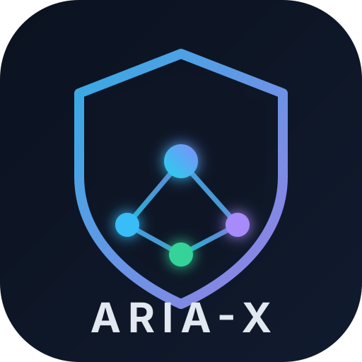
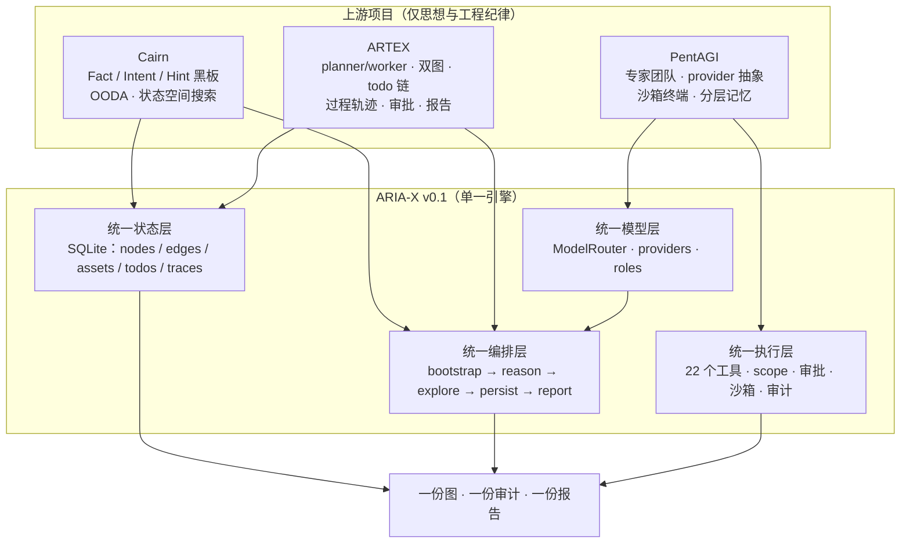
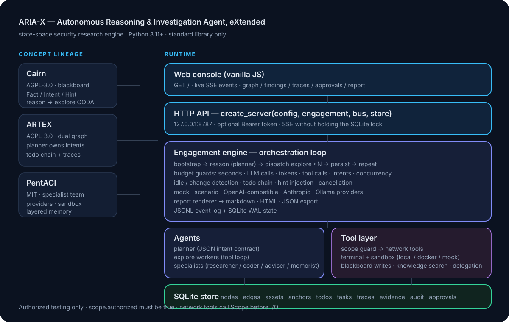
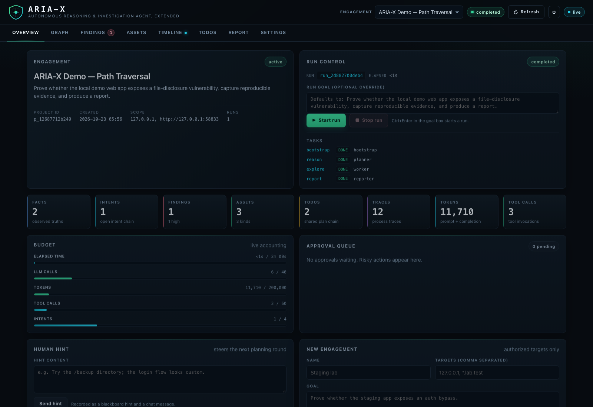
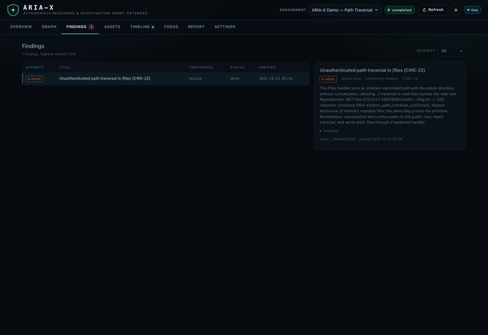
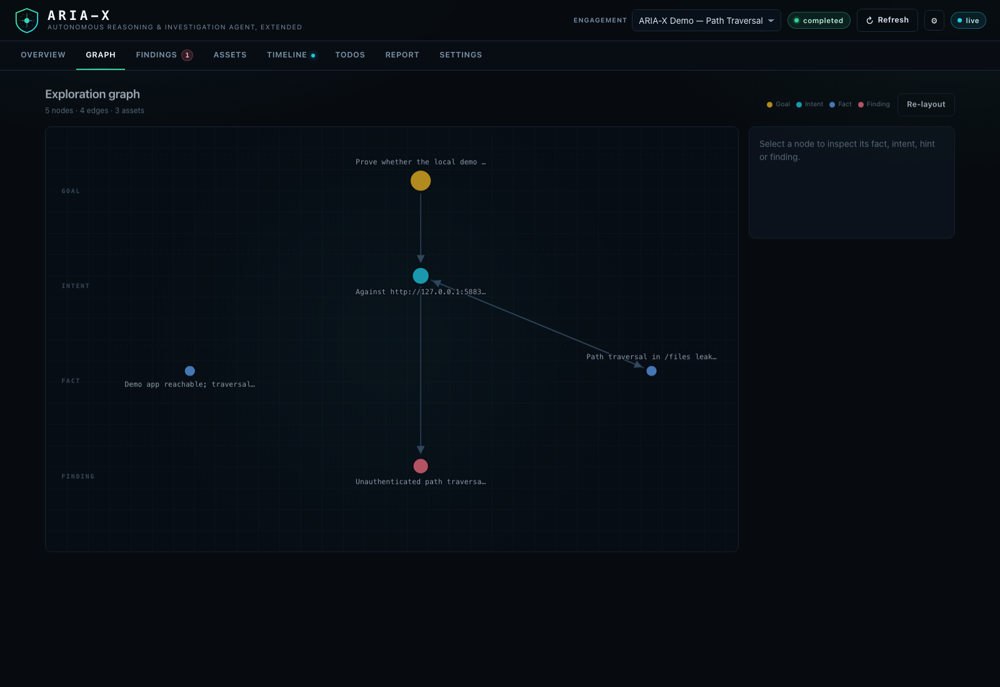

<p align="right">
  <strong>简体中文</strong> · <a href="README.en.md">English</a>
</p>

<p align="center">
  
</p>

<h1 align="center">ARIA-X</h1>

<p align="center">
  <strong>Autonomous Reasoning &amp; Investigation Agent, eXtended</strong><br>
  面向本地与隔离环境安全研究的自主推理与调查引擎（扩展版）
</p>

<p align="center">
  By <strong>01NGVI-QINGYI</strong>
</p>

<p align="center">
  <sub>本项目使用 <strong>DeepSeek Harness（DeepSeek-V4.1-Flash-1017）</strong> 辅助开发。</sub>
</p>

<p align="center">
  
  
  
  
  
</p>

---

## 致谢：站在三个开源项目的肩膀上

ARIA-X 的核心设计不是从零发明的。它把三个开源系统的**思想与工程纪律**拆开、重组，
再补上它们各自缺失的统一状态层与安全边界。感谢原作者与团队把这些系统公开：

| 项目 | 原作者 / 团队 | ARIA-X 从中学习到的核心思想 | 许可证 |
| --- | --- | --- | --- |
| **ARTEX** | [Autumn-27](https://github.com/Autumn-27)（原项目 `Autumn-27/ARTEX`，2026-10 已被作者删除） | 探索图 + 共享资产图的双图架构；planner 是唯一意图生成器；跨唤醒 todo 链；跨 worker 过程轨迹；审批门；图驱动的报告 | **AGPL-3.0** |
| **Cairn** | [起零衍迹 / oritera](https://github.com/oritera) | Fact / Intent / Hint 黑板；`bootstrap → reason → explore` 的状态空间搜索；无固定角色的 OODA worker；以“事实”而不是“任务”为中心 | **AGPL-3.0** |
| **PentAGI** | [VXControl](https://github.com/vxcontrol) | researcher / coder / adviser / memorist 专家分工；provider 抽象；沙箱化终端；分层记忆；把复杂任务委托给窄能力子代理 | **MIT** |

原作者的其他相关项目（用于理解 ARTEX 的设计脉络，也一并致谢）：

- [Norma](https://github.com/Autumn-27/Norma) —— ARTEX 使用的 agent SDK；
- [ScopeSentry](https://github.com/Autumn-27/ScopeSentry) —— 资产与范围测绘系统；
- [oritera/Cairn](https://github.com/oritera/Cairn) —— Cairn 主仓库；
- [vxcontrol/pentagi](https://github.com/vxcontrol/pentagi) —— PentAGI 主仓库。

> **关于链接的说明**：以上链接指向**原作者主页或原始项目**。ARTEX 原仓库已被作者删除，
> 因此没有可用的官方项目链接；本文不会把任何第三方镜像仓库的作者列为致谢对象。
> 研究时参考的上游版本为 ARTEX 0.3.15、Cairn 0.2.1、PentAGI v2.2.0。

### 关于 DeepSeek

**本项目使用 DeepSeek Harness（DeepSeek-V4.1-Flash-1017）辅助开发、优化与重构。**
具体来说，本项目的**架构梳理、代码重构、测试补齐、文档撰写与双语文案**均在该模型
的辅助下完成。DeepSeek 主要参与：

- 把三套异构架构（Go / Python / Go+TS）抽象成统一的 Python 状态机与数据模型；
- 生成并重构引擎、工具、LLM 适配、HTTP API 与 Web 控制台代码；
- 补齐单元测试、端到端演示与离线验证脚本；
- 撰写本 README、架构文档、融合说明与安全模型。

设计取舍、安全边界与最终代码由项目维护者审查。DeepSeek 是“加速器与重构工具”，
不是这三个上游项目的作者，也不替它们背书。

---

## ARIA-X 是什么

ARIA-X 是一个**可审计、可离线运行、零第三方依赖**的自主推理与调查引擎，面向本地与隔离环境中的安全研究。它把一次本地安全验证
建模成一次**有向状态空间搜索**：

- **起点**：配置范围内的本地测试资产；
- **终点**：可复现的 finding 与证据；
- **路径**：由 planner 提出、worker 执行、图结构记录，未知且需要搜索。

它不按固定剧本扫描，也不让模型“自由发挥”。每一次探索都必须落到黑板上的
Fact / Intent / Finding，并接受预算、scope、审批与审计的约束。

### 一句话区分

> 不是“把 ARTEX、Cairn、PentAGI 装进一个启动器轮流切换”，
> 而是把三者的不变量拆开，重写成**一套状态、一条主循环、一个工具层**。

---

## 三个项目与 ARIA-X 的关系

### 思想来源树



### 能力融合树（谁补了谁的短板）

```text
ARIA-X
├── 状态与搜索层 ............................. 来自 Cairn
│   ├── Fact / Intent / Hint 黑板
│   ├── bootstrap → reason → explore 的 OODA 闭环
│   ├── “事实优先”而非“任务清单优先”
│   └── 由 ARIA-X 新增：持久化、资产锚点、跨运行可读
│
├── 编排与图谱层 ............................. 来自 ARTEX
│   ├── planner 是唯一意图生成器（worker 不能自己造方向）
│   ├── 探索图（怎么想）+ 资产图（实际有什么）分离
│   ├── 跨唤醒 todo 链（长利用链不会丢上下文）
│   ├── 跨 worker 过程轨迹检索（站在彼此肩膀上）
│   ├── 审批门 + 图驱动报告
│   └── 由 ARIA-X 新增：统一节点表、SQLite、预算护栏
│
├── 执行与模型层 ............................. 来自 PentAGI
│   ├── researcher / coder / adviser / memorist 专家
│   ├── provider 抽象（OpenAI 兼容 / Anthropic / Ollama）
│   ├── local / docker / mock 沙箱终端
│   ├── 分层记忆与窄问题委托
│   └── 由 ARIA-X 新增：scope 强制、命令策略、审批强制
│
└── ARIA-X 自身新增 ............................ 融合后的“粘合剂”
    ├── 单一 ToolRegistry：参数校验 + scope + 审批 + 审计 + 轨迹
    ├── 四维预算：时间 / LLM 调用 / token / 工具调用
    ├── 单一 SQLite：项目 / 运行 / 节点 / 边 / 资产 / todo / 轨迹 / 证据
    ├── 零依赖 TF-IDF 记忆（支持 CJK）
    ├── 离线确定性 demo（无 API key）
    └── 本地 Web 控制台（SSE 实时事件、图、发现、报告）
```

### 目录级对应关系

```text
ARIA-X/
├── src/aria_x/store/        ← ARIA-X 新增：统一状态层（吸收 ARTEX 双图 + Cairn 黑板）
├── src/aria_x/engine/       ← Cairn 的搜索闭环 + ARTEX 的 planner/worker/todo/报告
├── src/aria_x/agents/       ← ARTEX 的角色边界 + PentAGI 的专家委托
├── src/aria_x/tools/        ← ARTEX 的审批/资产工具 + PentAGI 的沙箱/终端
├── src/aria_x/llm/          ← PentAGI 的 provider 抽象（重写为零依赖）
├── src/aria_x/memory/       ← PentAGI 的记忆思想（重写为 TF-IDF，无向量库）
├── src/aria_x/server/       ← ARIA-X 新增：HTTP API + SSE
├── src/aria_x/web/          ← ARIA-X 新增：零 CDN 控制台
└── docs/FUSION.md         ← 逐项说明“借鉴了什么、刻意没照搬什么”
```

更细的逐项映射见 [docs/FUSION.md](docs/FUSION.md)。

---

## 为什么是 ARIA-X

传统扫描器按固定剧本执行，覆盖可预期但无法处理未知路径；纯 LLM agent 又容易“看起来
在干活”，却留下无法复核的结论。ARIA-X 把自主性约束在一个**可验证的状态空间**里：

| 设计 | 解决的问题 |
| --- | --- |
| planner 是唯一意图生成器 | worker 不能各自发明方向，探索路径可以完整复盘 |
| 双图分离（探索图 / 资产图） | “我们怎么想的”和“目标实际有什么”不会互相污染 |
| Fact / Intent / Hint 黑板 | 每次决策都有输入、有证据、有来源，可审计 |
| 跨唤醒 todo 链 | 长任务不会因上下文丢失而重复劳动或遗忘分支 |
| 跨 worker 过程轨迹 | 后续 worker 可以检索前人的尝试，避免重复踩坑 |
| 四维预算护栏 | 时间 / LLM 调用 / token / 工具调用任一到顶即干净收尾并出报告 |
| scope + 命令策略 + 审批门 | 目标越界、破坏性命令、高风险动作都有明确拦截点 |
| 图驱动报告 | 报告只从已落库的事实/发现渲染，不允许模型凭空编造 |

---

## 核心特性

- **离线可验证**：`./aria-x demo` 不需要 API key、不需要联网，真实启动一个故意存在漏洞的
  本机目标，跑完整 engagement，产出 finding 与报告。
- **标准库零依赖**：运行时只用 Python 3.11+ 标准库，`pip` 不是必需的。
- **多种模型接入**：OpenAI 兼容接口（DeepSeek、vLLM、Ollama、OpenRouter 等）、
  Anthropic，以及 `mock` / `scenario` 两种确定性 provider。
- **范围强制**：网络工具在发出第一个包之前调用 `Scope.require_url/require_host`；
  支持主机、通配域名、CIDR、host:port、URL 前缀、deny 规则和每主机限速；
  HTTP 重定向逐跳重新授权，无法解析的主机名默认拒绝。
- **隔离终端**：`local` / `docker` / `mock` 三种沙箱；Docker 后端默认 `--network none`。
- **审批门**：`high` / `critical` 工具在 `safety.approval="ask"` 时写入审批记录并阻塞等待
  人工批准；`deny` 直接拒绝；`auto` 放行但仍受 scope 与命令策略约束。
- **证据链报告**：每次运行在 `runs/<run_id>/` 下生成 `report.md`、`report.html`、
  `findings.json`，并同时写入 SQLite 图、JSONL 事件流与审计表。
- **Web 控制台**：本地 HTTP API + SSE 实时事件流（默认只绑定 `127.0.0.1`，可选 Bearer token）。
- **可恢复的工程结构**：SQLite（WAL）持久化项目、运行、节点、边、资产、todo、任务、
  轨迹、证据、审批与审计。

---

## 架构

<p align="center">
  
</p>

一次 engagement 的主循环（[src/aria_x/engine/orchestrator.py](src/aria_x/engine/orchestrator.py)）：

```text
bootstrap（可选，一次最佳尝试）
   ↓
reason（planner：读黑板 → 产出 intents + todos 或 complete）
   ↓
dispatch（最多 max_concurrency 个 explore task，受 todo 依赖约束）
   ↓
worker OODA（工具调用 → fact / finding / assets / goal_proven）
   ↓
persist（节点 + 边 + 资产锚点 + 轨迹 + 证据 + todo 状态）
   ↓
预算 / 时间 / idle / 变化检测 → 下一轮或收尾
   ↓
report（Markdown + HTML + findings.json）+ JSONL 事件 + 审计
```

关键边界：

- **模型只通过 `ModelRouter` 调用**；角色到模型可分别配置（`[llm.role_models]`）。
- **工具只能通过 `ToolRegistry.execute` 执行**，统一做参数校验、scope、审批、取消检查。
- **所有目标网络 I/O 先过 `Scope`**；`web_search` 是外部研究流量，不算目标流量。
- **状态写入只有一个 SQLite 连接**（线程安全，WAL）；server 的 SSE 不持有 SQLite 锁。

详细模块、数据模型与 API 见 [docs/ARCHITECTURE.md](docs/ARCHITECTURE.md)。

---

## 快速开始

### 0. 环境

只需要 **CPython 3.11+**（推荐 3.12）。不需要 `pip install` 任何东西。

```bash
# 将 ARIA-X 目录复制/解压到本机任意位置
cd ARIA-X

# 方式一：使用自带启动器（自动定位 Python 并设置 PYTHONPATH）
./aria-x --version

# 方式二：手动设置 PYTHONPATH
export PYTHONPATH="$PWD/src"
python3.12 -m aria_x --version
```

### 1. 离线端到端演示（推荐第一条命令）

```bash
./aria-x demo
```

它会：

1. 在 `127.0.0.1` 的随机端口启动 `examples/demo_target.py`（故意存在路径穿越、缺失安全头、
   `/debug` 信息泄露的安全本机目标）；
2. 用内置的确定性 `DemoPolicy` 驱动 planner → worker → finding → report 的完整链路；
3. 输出 finding 数量与报告路径（`runs/demo-<时间戳>/<run_id>/report.md`）。

常用变体：

```bash
./aria-x demo --keep          # 演示结束后保留目标进程并打印 URL
./aria-x demo --serve         # 演示结束后打开 Web 控制台（:8787）
./aria-x demo --quiet         # 只输出最终状态与报告路径
```

### 2. 初始化真实配置

```bash
./aria-x init                 # 写入 configs/aria-x.toml
$EDITOR configs/aria-x.toml
```

至少修改：

```toml
[scope]
authorized = true                   # 只有拿到书面授权后才设为 true
targets = ["127.0.0.1"]             # 主机 / *.example.test / 10.0.0.0/24 / URL 前缀

[llm]
provider = "openai"                 # 也支持 anthropic / ollama / scenario / mock
base_url = "https://api.deepseek.com/v1"
model = "deepseek-chat"
# api_key 更推荐放在环境变量：
```

```bash
export ARIA_X_API_KEY="sk-..."
./aria-x doctor --llm                 # 检查配置并做一次真实模型调用
```

### 3. 跑一次 engagement

```bash
./aria-x -c configs/aria-x.toml run \
  --name "Staging review" \
  --goal "评估 staging.example.test 的 Web 攻击面，确认可复现的高危问题并给出修复建议。"
```

终止后查看：

```bash
./aria-x projects             # 项目列表
./aria-x graph                # 最新项目的黑板摘要
./aria-x report               # 最新报告路径（--open 打开）
./aria-x export -o out.json   # 完整 JSON 导出
```

### 4. Web 控制台

```bash
export ARIA_X_AUTH_TOKEN="$(python3 -c 'import secrets; print(secrets.token_hex(16))')"
./aria-x serve --open
```

默认地址 `http://127.0.0.1:8787`。控制台提供项目、图、发现、资产、轨迹、审批、
实时 SSE 事件与报告视图。HTTP API 清单见 [docs/ARCHITECTURE.md](docs/ARCHITECTURE.md)。

---

## 命令行

| 命令 | 作用 |
| --- | --- |
| `aria-x init` | 生成 `configs/aria-x.toml` 起始配置 |
| `aria-x demo` | 离线端到端演示（`--keep` 保留目标，`--serve` 打开控制台） |
| `aria-x run --goal ...` | 无头运行一次 engagement |
| `aria-x serve` | 启动 Web 控制台（默认 `127.0.0.1:8787`） |
| `aria-x doctor [--llm]` | 检查 Python、配置、目录、工具、引擎、服务器、沙箱与模型连通性 |
| `aria-x tools [--json]` | 列出工具目录（名称、风险、是否需要 scope） |
| `aria-x projects` / `aria-x graph` / `aria-x report` / `aria-x export` | 查看持久化结果 |
| `./aria-x ...` | 免安装启动器：等价于 `PYTHONPATH=src python -m aria_x ...` |

全局参数：`-c/--config <path>`、`--version`。`-c` 可放在子命令前或后。
退出码：`0` 成功、`1` 运行未完成、`2` 配置/参数错误、`130` 人工中断。

---

## 配置

完整示例见 [configs/aria-x.example.toml](configs/aria-x.example.toml)。核心片段：

```toml
name = "Staging engagement"
data_dir = "data"
runs_dir = "runs"

[scope]
authorized = true
targets = ["127.0.0.1", "*.staging.example.test", "10.10.0.0/24"]
deny = []
allow_private = true
allow_loopback = true
max_rps = 3.0

[llm]
provider = "openai"            # mock | scenario | openai | anthropic | ollama
base_url = "https://api.deepseek.com/v1"
model = "deepseek-chat"
temperature = 0.2
max_tokens = 4096
max_retries = 2
tool_mode = "auto"             # auto | native | prompt

[budget]
max_seconds = 1800
max_llm_calls = 160
max_tokens = 1200000
max_tool_calls = 400
max_steps_per_task = 18
max_intents_per_reason = 3
max_concurrency = 2
max_total_intents = 40

[sandbox]
backend = "local"              # local | docker | mock
image = "kalilinux/kali-rolling"
network = "none"               # 仅在隔离实验环境改为 "bridge"
timeout = 120

[safety]
approval = "auto"              # auto | ask | deny
block_destructive = true
redact_secrets = true

[server]
host = "127.0.0.1"
port = 8787
auth_token = ""                # 或 ARIA_X_AUTH_TOKEN

[engine]
language = "zh"
bootstrap = true
max_idle_rounds = 2
```

环境变量：`ARIA_X_PROVIDER`、`ARIA_X_BASE_URL`、`ARIA_X_API_KEY`、`ARIA_X_MODEL`、
`ARIA_X_DATA_DIR`、`ARIA_X_AUTH_TOKEN`、`ARIA_X_SANDBOX`、`ARIA_X_APPROVAL`。

---

## 工具（22 个）

| 类别 | 工具 | 风险 |
| --- | --- | --- |
| 终端 / 文件 | `terminal_exec`(high)、`file_read`(medium)、`file_write`(high)、`file_list`(low) | 沙箱 + 路径 jail |
| 网络（scope） | `http_request`、`dns_lookup`、`port_scan`(high)、`tls_probe`、`web_probe` | 逐次 scope 授权 |
| 外部研究 | `web_search` | 不接触目标 |
| 黑板 | `add_fact`、`add_finding`、`add_asset`、`anchor_node`、`graph_query` | 图写入 |
| 计划 / 记忆 | `todo_update`、`search_traces`、`memory_store`、`memory_search` | 状态维护 |
| 协作 | `delegate_specialist`、`prove_goal`、`scope_check` | 低风险 |

完整参数、风险与示例见 [docs/TOOLS.md](docs/TOOLS.md)。

---

## 数据模型：一张图，而不是三份日志

统一 SQLite schema（15 张表）承载三家语义：

```text
projects ── runs ── tasks
   │
   ├── nodes (goal / intent / fact / finding / hint / note / guide)
   │     └── edges (spawns / yields / derived_from / proves / supports / depends_on)
   │           └── anchors ── assets (root_domain / subdomain / host / ip / service / endpoint / app / credential / artifact)
   │
   ├── todos        （跨唤醒计划链）
   ├── traces       （worker 过程记录，可跨 worker 检索）
   ├── evidence     （finding 的证据、哈希、摘要）
   ├── approvals    （高风险工具的人工审批）
   └── audit        （scope / 审批 / 策略决定）
```

一个 finding 同时是：Cairn 意义上的“已确认事实”、ARTEX 意义上的“漏洞节点”，
并通过 anchor 关联到 PentAGI 式专家执行时发现的资产。报告、覆盖度与攻击路径都从这张图
渲染，而不是从对话日志拼凑。

---

## 安全模型

> 本节描述代码中的技术防护，不构成对使用范围的授权。允许与禁止的使用场景以文末
> [《许可与免责声明》](#许可与免责声明) 为准。

### 授权启动门

```toml
[scope]
authorized = true
targets = ["127.0.0.1"]
```

缺一即抛 `ConfigError`，不会创建 run。项目 scope 若显式 `authorized=false` 也会被拒绝。

### 目标级 scope

- 精确主机、通配域名、CIDR、host:port、URL 前缀；
- `deny` 优先于 allow；
- `allow_private` / `allow_loopback` 控制私网与回环；
- 每主机限速；HTTP 重定向逐跳复核；无法解析的主机名默认拒绝。

### 高风险工具审批

| 模式 | 行为 |
| --- | --- |
| `auto`（默认） | 直接执行，仍受 scope、workdir jail 与命令策略约束 |
| `ask` | 创建审批记录 + `approval.requested` 事件，阻塞等待人工批准（最长 300 秒） |
| `deny` | 直接拒绝并写审计 |

### 不防什么

- 恶意/被投毒的模型服务；
- 目标对模型的 prompt injection（工具输出被当作数据，但没有专门分类器）；
- 主机/物理层逃逸；
- `terminal_exec` 的间接寻址（命令中的字面 URL/IP 只能启发式检查；真正边界是 Docker 沙箱）。

完整威胁模型与披露流程见 [docs/SECURITY.md](docs/SECURITY.md)。

---

## 界面

控制台是零框架、零 CDN 的本地 SPA，默认只监听 `127.0.0.1`。以下截图来自真实离线 demo：

<p align="center">
  
</p>

<p align="center">
  
</p>

<p align="center">
  
</p>

更多界面截图（资产、时间线、报告、TODO）见 [assets/](assets/)。

---

## 报告产物

每次运行写入 `runs/<run_id>/`：

```text
report.md        # 人读的 Markdown（摘要、范围、发现、攻击路径、覆盖与盲点）
report.html      # 自包含深色 HTML（无 CDN）
findings.json    # 发现的结构化导出
```

同时：

- `data/aria-x.db`：SQLite 状态（项目、节点、边、资产、todo、任务、轨迹、证据、审批、审计）；
- `data/events.jsonl`：追加式事件流（`aria-x serve` 的 SSE 重放来源）；
- `data/<project_id>-export.json`：`aria-x export` 的完整导出。

---

## Docker

```bash
docker build -f docker/Dockerfile -t aria-x:0.1.0 .
mkdir -p data runs
docker run --rm -p 127.0.0.1:8787:8787 \
  --user "$(id -u):$(id -g)" \
  -e ARIA_X_AUTH_TOKEN="$(openssl rand -hex 16)" \
  -v "$PWD/data:/app/data" -v "$PWD/runs:/app/runs" \
  aria-x:0.1.0
```

或：

```bash
export ARIA_X_AUTH_TOKEN="$(openssl rand -hex 16)"
export ARIA_X_API_KEY="sk-..."
export ARIA_X_UID="$(id -u)" ARIA_X_GID="$(id -g)"
docker compose -f docker/docker-compose.yml up --build
```

镜像只包含 ARIA-X 本体（标准库），不含扫描工具。Kali 工具镜像与 Docker 沙箱说明见
[docs/DEPLOYMENT.md](docs/DEPLOYMENT.md) 与 [docker/kali-sandbox.md](docker/kali-sandbox.md)。

---

## 测试与自检

```bash
bash scripts/verify.sh          # 单元测试 + 离线端到端 demo（无网络、无 API key）
bash scripts/dev.sh test        # 只跑单元测试
bash scripts/dev.sh doctor      # 环境自检
```

当前状态：**202 个测试**，在 Python 3.11.14 与 3.12.12 上均通过；`verify.sh` 退出码 0。

`scripts/verify.sh` 的 Python 发现顺序：`$ARIA_X_PYTHON` → `python3.12` → `python3.11` → 满足 ≥3.11 的 `python3`。
不执行任何 `pip install`。

---

## 项目结构

```text
ARIA-X/
├── aria-x                       # 免安装启动器
├── pyproject.toml             # 可选安装（无运行时依赖）
├── src/aria_x/
│   ├── cli.py                 # 命令行入口
│   ├── config.py              # TOML/JSON 配置、环境变量、校验
│   ├── models.py              # 节点 / 资产 / todo / 轨迹 / 证据
│   ├── events.py              # 事件总线、JSONL 持久化、SSE 重放
│   ├── store/                 # SQLite schema 与 DAO
│   ├── engine/                # 预算、调度、上下文、orchestrator、engagement
│   ├── agents/                # Agent 循环、角色、prompts、workers
│   ├── tools/                 # 22 个工具、scope、沙箱、审批门
│   ├── llm/                   # provider、router、mock、scenario、JSON 修复
│   ├── memory/                # 零依赖 TF-IDF 检索（CJK）
│   ├── report/                # Markdown / HTML / findings.json
│   ├── server/                # ThreadingHTTPServer API + SSE
│   └── web/                   # 零 CDN 控制台（HTML/CSS/JS）
├── tests/                     # 202 个单元/集成测试
├── examples/                  # 本机脆弱靶场、demo 配置、scenario
├── configs/                   # 示例配置
├── docs/                      # 架构、融合、工具、安全、部署、路线图
├── docker/                    # Dockerfile、compose、Kali 沙箱说明
├── scripts/                   # bootstrap / dev / verify
├── assets/                    # logo、架构图、控制台截图
├── .github/                   # CI、issue/PR 模板
├── CONTRIBUTING.md            # 贡献指南
├── CODE_OF_CONDUCT.md         # 行为准则
├── SECURITY.md                # 安全披露流程
├── CITATION.cff               # 引用信息
├── LICENSE                    # AGPL-3.0
├── NOTICE.md                  # 上游归属
└── THIRD_PARTY.md             # MIT 文本与第三方声明
```

---

## 已知限制（诚实清单）

- **LLM 质量决定上限**：ARIA-X 约束的是流程与证据，不保证模型能发现特定漏洞。
- **命令策略是启发式**：`CommandPolicy` 拦截常见破坏性模式，不是完整沙箱；
  真正的隔离边界是 Docker 后端。
- **Docker 沙箱不是 scope 边界**：目标授权由 `Scope` 在工具层强制。
- **个人/单机规模**：SQLite 单写者模型，适合单机、单团队；没有分布式调度。
- **报告只有 Markdown/HTML/JSON**：暂不生成 PDF。
- **没有内置漏洞利用库**：ARIA-X 负责推理、调用工具、记录证据；具体利用由模型生成，
  并受 scope、命令策略与强制审批门约束。
- **`scenario` provider 是测试替身**：它按 JSON 脚本重放，不是“模型能力”的证明。
- **上游运行时未内置**：ARTEX 的 norma/Kali/MITM、Cairn 的 Claude Code/Codex worker 容器、
  PentAGI 的 Graphiti/Neo4j/pgvector 与 Kali MCP 全家桶均未搬入；ARIA-X 重写了核心循环。

路线图见 [docs/ROADMAP.md](docs/ROADMAP.md)。

---

## 许可证

ARIA-X 以 **GNU Affero General Public License v3.0（AGPL-3.0-or-later）** 发布，
完整文本见 [LICENSE](LICENSE)。

选择 AGPL-3.0 的原因：

- **ARTEX** 与 **Cairn** 均使用 **AGPL-3.0**，ARIA-X 与它们保持同一许可证；
- **PentAGI** 使用 **MIT**，MIT 与 AGPL-3.0 兼容，可以并入 AGPL 项目；
- ARIA-X 虽然重写了概念而非复制代码，但为了覆盖未来任何代码级复用，并保持与两个 AGPL
  上游一致，选择 AGPL-3.0-or-later 作为统一许可证。

上游归属与“未复制代码”的说明见 [NOTICE.md](NOTICE.md)；PentAGI 的 MIT 文本与版权声明
复制在 [THIRD_PARTY.md](THIRD_PARTY.md)。

> **AGPL-3.0 §13**：如果你通过网络向他人提供 ARIA-X 服务，必须向用户提供对应源码
> （例如在控制台或服务页面放置可访问的 Source 链接）。分发二进制或容器镜像时，
> 必须附带 `LICENSE` 与 `NOTICE.md`。

---

## 文档

| 文档 | 内容 |
| --- | --- |
| [docs/ARCHITECTURE.md](docs/ARCHITECTURE.md) | 模块、数据流、数据模型、HTTP API、事件 |
| [docs/FUSION.md](docs/FUSION.md) | 与 ARTEX / Cairn / PentAGI 的逐项映射与取舍 |
| [docs/TOOLS.md](docs/TOOLS.md) | 22 个工具的参数、风险、scope 行为与示例 |
| [docs/SECURITY.md](docs/SECURITY.md) | 技术防护、威胁模型、秘密处理、披露流程 |
| [docs/DEPLOYMENT.md](docs/DEPLOYMENT.md) | 本地/容器部署、模型接入、沙箱、排障 |
| [docs/ROADMAP.md](docs/ROADMAP.md) | 已实现 / 下一步 / 明确不做 |
| [CHANGELOG.md](CHANGELOG.md) | v0.1.0 变更记录 |
| [docs/CONTRACTS.md](docs/CONTRACTS.md) | 内部构建契约（开发参考） |
| [docs/GITHUB.md](docs/GITHUB.md) | GitHub About、topics 与发布清单 |

---

## 再次致谢

- 感谢 [Autumn-27](https://github.com/Autumn-27) 的 **ARTEX**：双图、planner/worker、
  todo 链与过程轨迹，是 ARIA-X 编排层最重要的参照。
- 感谢 [起零衍迹 / oritera](https://github.com/oritera) 的 **Cairn**：Fact / Intent / Hint
  黑板与 OODA 搜索，让 ARIA-X 有了“状态空间”而不是“任务队列”。
- 感谢 [VXControl](https://github.com/vxcontrol) 的 **PentAGI**：专家分工、provider 抽象、
  沙箱与记忆，让 ARIA-X 的执行层足够强。

如果这三个项目对你有帮助，请优先给**原作者的项目**点 Star、提 Issue 或参与贡献。

---

## 许可与免责声明

### 开源许可

本仓库的发布许可证是 **GNU Affero General Public License v3.0（AGPL-3.0）**，条款全文见根目录的
[LICENSE](LICENSE)。该许可证允许使用、修改与再分发，但衍生作品必须继续采用 AGPL-3.0。
若修改版以网络服务形式对外提供，服务使用者应能获取对应的完整源码。

### 使用边界（作者补充约定）

开源许可证本身并不限制软件的使用领域。以下内容是作者在许可证之外提出的补充约定，
请在下载、安装或运行前认真阅读。本节不构成法律意见，也不能替代你所在组织的合规审查。

**可以用于**

- 阅读、学习、教学、学术讨论与代码审阅；
- 在完全隔离的本地环境中进行原理性验证与实验；
- 对项目本身进行非攻击性的开发、测试与改进。

**不得用于**

- 不得对任何网站、在线服务或联网系统进行扫描、探测、漏洞利用或攻击——无论目标是否为你所有、是否已获得授权；
- 不得用于真实环境中的渗透测试、攻防演练或生产系统；
- 不得用于非法入侵、数据窃取、勒索、拒绝服务，或任何破坏性、犯罪性活动；
- 不得用于违反所在国家或地区法律法规的行为。

### 合规义务

使用者应自行确保使用行为符合所在地关于网络安全、数据保护与计算机犯罪的法律法规
（例如中国大陆的《网络安全法》《数据安全法》《个人信息保护法》及相关司法解释）。
因使用本项目产生的一切法律责任与后果，由使用者自行承担。

### 免责声明

本项目按现有代码与文档原样提供，未对适销性、特定用途适用性或不侵权作出任何承诺。
作者与贡献者不对使用或无法使用本项目所造成的任何直接或间接损失、数据丢失、系统损坏、
业务中断或法律争议承担责任。你一旦下载、安装、复制或运行本项目，即视为接受本节全部内容；
如不同意，请立即停止使用并删除所有副本。

---

<p align="center">
  <sub>ARIA-X v0.1.0 · AGPL-3.0-or-later · Project by 01NGVI-QINGYI · 仅供本地隔离环境学习与研究</sub>
</p>
