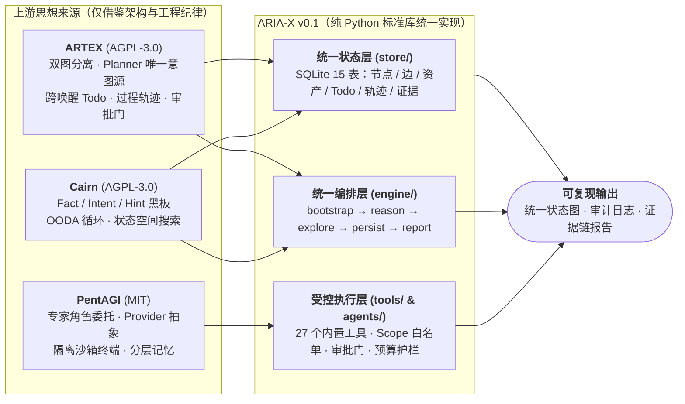
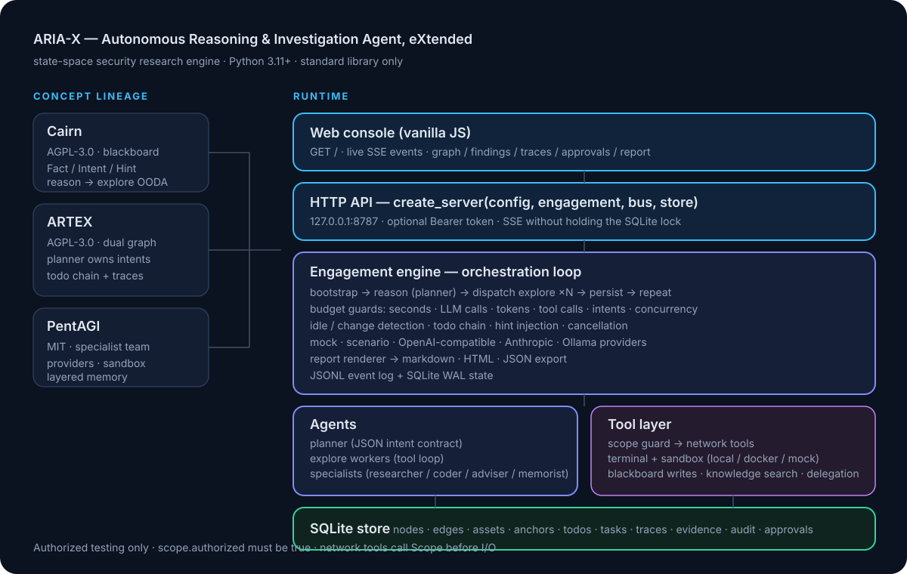
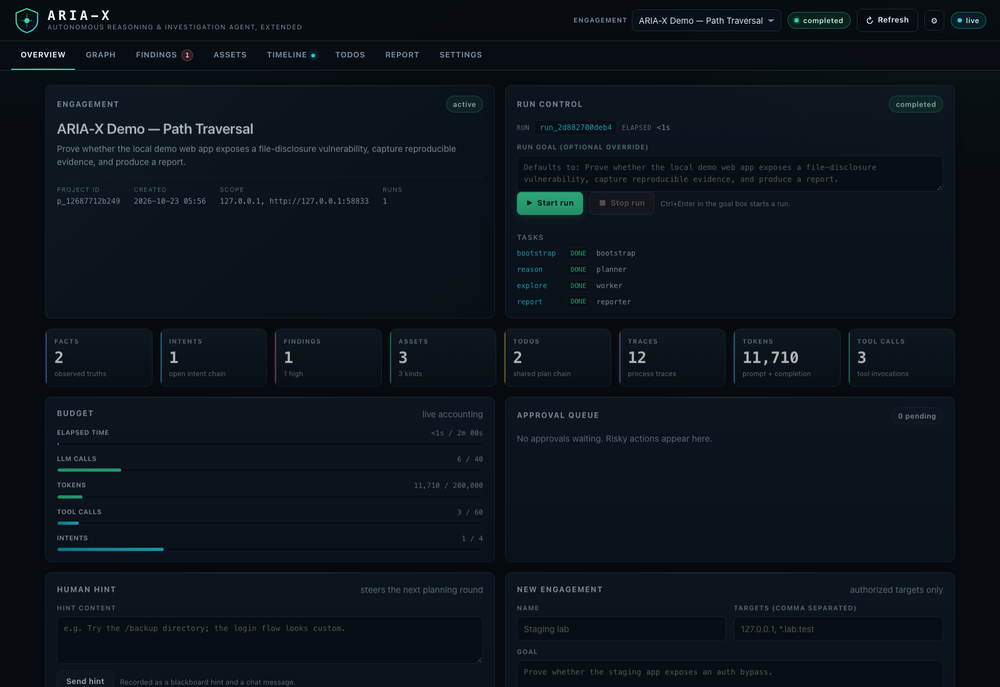
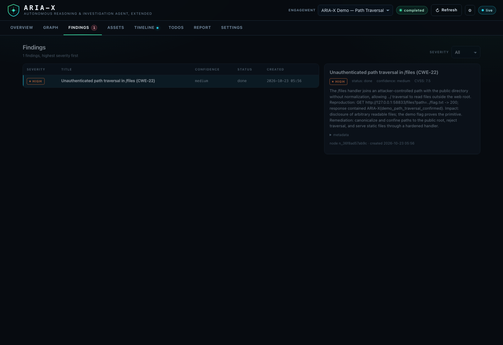
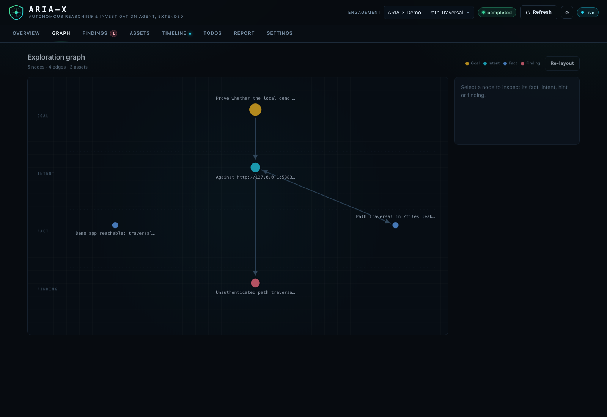

<p align="right">
  <strong>简体中文</strong> · <a href="README.en.md">English</a> · <a href="README.ja.md">日本語</a>
</p>

<p align="center">
  
</p>

<h1 align="center">ARIA-X</h1>

<p align="center">
  <strong>Autonomous Reasoning &amp; Investigation Agent, eXtended</strong><br>
  从自主推理到可核验的发现：安全研究、执行编排与证据报告一体化
</p>

<p align="center">
  By <strong>01NGVI-QINGYI</strong>
</p>

<p align="center">
  <sub>本项目使用 <strong>DeepSeek Harness（DeepSeek-V4.1-Flash-1017）</strong> 辅助开发。</sub>
</p>

<p align="center">
  
  
  
  
  
</p>

---

## ARIA-X 是什么

**ARIA-X 将自主推理、受控工具执行与证据管理整合为一套可复盘的安全研究工作流。** 面向本地及隔离实验环境，基于 Python 标准库构建，支持离线运行，并把每一步探索记录为可追溯的状态与证据。

每次验证任务都沿着可审计的**有向状态空间搜索路径**推进：
- **起点**：配置白名单（`Scope`）内的本地测试资产；
- **终点**：具备可复现证据链的调查发现（`Finding`）；
- **路径**：由 `Planner` 提出假设与意图（`Intent`），由 `Worker` 调用工具收集事实（`Fact`），全程记录在持久化图结构中。

**设计核心：让每次探索都有目标、依据和可检查的结果。**

> Planner 负责生成研究意图，Worker 负责验证并收集证据；`Fact / Intent / Finding` 黑板与持久化图谱记录整个过程。`Scope`、执行预算、命令策略与审批门贯穿工具调用，最终形成可追溯的发现、执行轨迹与报告。

---

## 架构融合与演进关系

### 紧凑谱系与融合图



### 各层能力融合对照

| 架构层次 | 思想来源 | 吸收的核心机制 | ARIA-X 补齐的工程与安全边界 | 对应源码目录 |
| :--- | :--- | :--- | :--- | :--- |
| **状态与搜索层** | **Cairn** | `Fact / Intent / Hint` 黑板；`bootstrap → reason → explore` 闭环；事实驱动而非任务列表驱动 | SQLite WAL 持久化、资产锚点关联（`anchors`）、跨运行状态持久化 | `src/aria_x/store/`<br/>`src/aria_x/engine/` |
| **编排与图谱层** | **ARTEX** | Planner 唯一意图生成（防止 Worker 偏航）；探索图与资产图分离；跨唤醒 Todo 链；跨 Worker 轨迹检索；图驱动报告 | 统一 15 表 Schema、四维预算硬上限（时间 / Token / LLM / 工具调用） | `src/aria_x/engine/`<br/>`src/aria_x/report/` |
| **执行与模型层** | **PentAGI** | `researcher / coder / adviser / memorist` 窄问题委托；多模型路由；沙箱终端；分层记忆 | 零依赖 Provider 实现、零依赖 CJK TF-IDF 检索、强制 Scope 与命令策略拦截 | `src/aria_x/agents/`<br/>`src/aria_x/tools/`<br/>`src/aria_x/llm/` |
| **粘合与验证层** | **ARIA-X 原创** | 单一 `ToolRegistry` 拦截点、无 API Key 确定性离线靶场演示（`./aria-x demo`）、零 CDN 本地 SSE 控制台 | 默认仅绑定 `127.0.0.1`、自动脱敏（`redact_secrets`）、全链路 JSONL 与 SQLite 审计 | `src/aria_x/server/`<br/>`src/aria_x/web/` |

更详细的逐项对比与取舍说明请参阅 [docs/FUSION.md](docs/FUSION.md)。

---

## 以证据驱动的状态空间推理

ARIA-X 将上下文感知的智能体推理与结构化状态管理、工具执行策略和审计机制结合起来：从目标出发提出意图，通过受控工具验证假设，沉淀事实，再由持久化证据生成报告。**自主性推动探索，结构化证据支撑结论。**

| 机制设计 | 解决的核心问题 |
| :--- | :--- |
| **Planner 统一生成意图** | 将研究方向组织为可追踪的 Intent，使 Worker 围绕明确目标开展验证 |
| **双图分离（探索图 / 资产图）** | 将“模型的推理假设”与“目标环境中已确认的客观资产”严格隔离 |
| **Fact / Intent / Hint 黑板** | 每一步决策均有明确的输入依据、证据哈希与来源追溯 |
| **跨唤醒 Todo 链与过程轨迹** | 保存任务依赖与探索历史，为多步验证和后续 Worker 提供可检索的上下文 |
| **四维预算护栏** | 时间、LLM 调用次数、Token 消耗、工具调用次数任一达到阈值即平稳收尾并生成报告 |
| **Scope + 命令策略 + 审批门** | 目标越界、高风险动作与破坏性指令均在 `ToolRegistry` 入口处被统一拦截 |
| **图驱动报告** | 从持久化节点与证据渲染报告，使发现能够回溯至具体的验证路径 |

---

## 核心特性

- **离线端到端可验证**：运行 `./aria-x demo` 无需 API Key、无需联网，即可在本机 `127.0.0.1` 随机端口启动内置教学靶场，完整跑通 `Planner → Worker → Finding → Report` 全流程。
- **Python 标准库零依赖**：运行时仅需 CPython 3.11+ 标准库，无需 `pip install` 任何第三方包。
- **多模型无缝接入**：原生支持 OpenAI 兼容接口（DeepSeek、vLLM、Ollama、OpenRouter 等）与 Anthropic，同时提供 `mock` 与 `scenario` 两种确定性测试替身。
- **严格的 Scope 白名单**：所有目标网络工具在发出首个数据包前均调用 `Scope.require_url/require_host`；支持精确主机、通配域名、CIDR、`host:port`、URL 前缀、`deny` 规则与单主机限速；HTTP 重定向逐跳重新校验，无法解析的主机名默认拒绝。
- **多后端隔离终端**：支持 `local`、`docker` 与 `mock` 三种沙箱后端；Docker 后端默认启用 `--network none`。
- **分级审批门**：当 `safety.approval = "ask"` 时，`high` / `critical` 风险工具会生成审批记录并阻塞等待人工确认；`deny` 直接拒绝；`auto` 放行但依然受 Scope 与命令策略约束。
- **结构化证据链报告**：每次运行在 `runs/<run_id>/` 下生成 `report.md`、`report.html` 与 `findings.json`，并与 SQLite 状态图、JSONL 事件流及审计表一一对应。
- **零 CDN 本地控制台**：内置基于原生 HTML/CSS/JS 与 SSE 实时事件流的本地 Web 控制台（默认仅绑定 `127.0.0.1:8787`，支持 Bearer Token 认证）。
- **交互式 PTY 会话（v0.1.1）**：新增 `session_open`、`session_send`、`session_read`、`session_close`、`session_list`，用于在本机隔离实验环境中驱动需要持续终端交互的程序；创建会话和发送输入均为高风险操作，必须经过命令策略、Scope 校验与审批门。每次运行最多 4 个并发会话，空闲会话会被清理；详情见 [更新日志](CHANGELOG.md)。

---

## 架构与主循环

<p align="center">
  
</p>

单次验证运行的主循环（详见 [src/aria_x/engine/orchestrator.py](src/aria_x/engine/orchestrator.py)）：

```text
bootstrap（可选：单次初始探测与基线事实收集）
   ↓
reason（Planner 读取黑板 → 生成下一批 Intents + Todos，或判定完成）
   ↓
dispatch（按依赖关系并发派发最多 max_concurrency 个 Explore 任务）
   ↓
worker OODA（调用受控工具 → 提交 Fact / Finding / Assets / Goal Proven）
   ↓
persist（原子化写入节点、边、资产锚点、过程轨迹、证据与 Todo 状态）
   ↓
预算 / 超时 / 空转检测 → 进入下一轮推理或平稳收尾
   ↓
report（生成 Markdown + HTML + findings.json）+ JSONL 事件归档 + 审计落库
```

**关键架构边界**：
1. **模型调用唯一入口**：所有模型请求必须经过 `ModelRouter`，支持按角色（`planner / worker / specialist / reporter`）独立配置模型（`[llm.role_models]`）。
2. **工具执行唯一入口**：所有工具调用必须经过 `ToolRegistry.execute`，统一完成参数 Schema 校验、Scope 鉴权、审批门拦截与审计记录。
3. **目标流量与外部检索隔离**：目标探测工具必须通过 `Scope` 校验；`web_search` 属于公开资料检索，不接触测试目标。
4. **单连接线程安全写入**：状态持久化使用启用了 WAL 模式的单一线程安全 SQLite 连接；HTTP Server 的 SSE 推送通过内存事件队列订阅，不持有数据库锁。

完整的模块划分、数据模型与 HTTP API 说明见 [docs/ARCHITECTURE.md](docs/ARCHITECTURE.md)。

---

## 快速开始

### 0. 环境要求

仅需 **CPython 3.11+**（推荐 3.12），无需安装任何第三方依赖。

```bash
git clone https://github.com/01NGVI-QINGYI/ARIA-X.git
cd ARIA-X

# 方式一：使用仓库自带的免安装启动器（自动定位 Python 并设置 PYTHONPATH）
./aria-x --version

# 方式二：手动指定 PYTHONPATH
export PYTHONPATH="$PWD/src"
python3.12 -m aria_x --version
```

### 1. 运行离线端到端演示（推荐第一步）

```bash
./aria-x demo
```

该命令将在完全离线的本机环境中执行以下步骤：
1. 在 `127.0.0.1` 的随机空闲端口启动内置教学靶场 `examples/demo_target.py`（包含路径边界缺陷、安全响应头缺失与 `/debug` 信息泄露等教学示例）；
2. 使用确定性策略 `DemoPolicy` 驱动 `Planner → Worker → Finding → Report` 完整闭环；
3. 输出发现汇总与报告路径（`runs/demo-<时间戳>/<run_id>/report.md`）。

常用参数：
```bash
./aria-x demo --keep          # 演示结束后保留本机靶场进程并打印访问地址
./aria-x demo --serve         # 演示结束后自动启动本地 Web 控制台（127.0.0.1:8787）
./aria-x demo --quiet         # 仅输出最终状态与报告路径
```

### 2. 初始化配置文件与接入模型

```bash
./aria-x init                 # 生成默认配置文件 configs/aria-x.toml
```

编辑 `configs/aria-x.toml`，确认本地授权范围与模型配置：

```toml
[scope]
authorized = true                   # 仅在确认属于本机隔离实验环境时设为 true
targets = ["127.0.0.1"]             # 严格限定为本机回环或隔离实验网段

[llm]
provider = "openai"                 # 支持 openai / anthropic / ollama / scenario / mock
base_url = "https://api.deepseek.com/v1"
model = "deepseek-chat"
```

通过环境变量配置 API Key 并执行环境自检：

```bash
export ARIA_X_API_KEY="your-api-key"
./aria-x doctor --llm               # 校验配置、目录、沙箱及模型连通性
```

### 3. 启动本地验证任务与查看结果

```bash
./aria-x -c configs/aria-x.toml run \
  --name "Local lab verification" \
  --goal "验证本机隔离靶场服务的配置缺陷与路径边界，输出可复现的证据与修复建议。"
```

任务完成后，可通过命令行查看持久化结果：

```bash
./aria-x projects                   # 查看项目列表
./aria-x graph                      # 查看最新项目的黑板与状态图摘要
./aria-x report                     # 打印最新报告路径（加 --open 可直接打开）
./aria-x export -o out.json         # 导出完整项目图谱与证据 JSON
```

### 4. 启动本地 Web 控制台

```bash
export ARIA_X_AUTH_TOKEN="$(python3 -c 'import secrets; print(secrets.token_hex(16))')"
./aria-x serve --open
```

默认监听 `http://127.0.0.1:8787`，提供项目总览、状态探索图、发现详情、资产列表、执行轨迹、人工审批与实时 SSE 事件流视图。

---

## 命令行参考

| 命令 | 说明 |
| :--- | :--- |
| `aria-x init` | 生成初始配置文件 `configs/aria-x.toml` |
| `aria-x demo` | 运行离线端到端本机演示（支持 `--keep`、`--serve`、`--quiet`） |
| `aria-x run --goal ...` | 按指定配置与目标无头运行一次验证任务 |
| `aria-x serve` | 启动本地 Web 控制台（默认绑定 `127.0.0.1:8787`） |
| `aria-x doctor [--llm]` | 检查 Python 版本、配置、目录、工具、引擎、沙箱及模型连通性 |
| `aria-x tools [--json]` | 列出全部 27 个内置工具的名称、风险等级与 Scope 要求 |
| `aria-x projects / graph / report / export` | 查询项目列表、状态图摘要、报告路径或导出完整 JSON |

- **全局参数**：`-c/--config <path>`（可置于子命令前或后）、`--version`。
- **退出码**：`0` 正常完成、`1` 运行未完成、`2` 配置或参数错误、`130` 人工中断。

---

## 配置示例

完整配置说明见 [configs/aria-x.example.toml](configs/aria-x.example.toml)，核心配置项如下：

```toml
name = "Local lab engagement"
data_dir = "data"
runs_dir = "runs"

[scope]
authorized = true
targets = ["127.0.0.1"]
deny = []
allow_private = true
allow_loopback = true
max_rps = 3.0

[llm]
provider = "openai"            # mock | scenario | openai | anthropic | ollama
base_url = "https://api.deepseek.com/v1"
model = "deepseek-chat"
temperature = 0.2
max_tokens = 4096
max_retries = 2
tool_mode = "auto"             # auto | native | prompt

[budget]
max_seconds = 1800
max_llm_calls = 160
max_tokens = 1200000
max_tool_calls = 400
max_steps_per_task = 18
max_intents_per_reason = 3
max_concurrency = 2
max_total_intents = 40

[sandbox]
backend = "local"              # local | docker | mock
image = "python:3.12-slim"
network = "none"               # 默认禁用容器网络；仅在隔离实验环境按需调整
timeout = 120

[safety]
approval = "auto"              # auto | ask | deny
block_destructive = true
redact_secrets = true

[server]
host = "127.0.0.1"
port = 8787
auth_token = ""                # 推荐通过 ARIA_X_AUTH_TOKEN 环境变量注入

[engine]
language = "zh"
bootstrap = true
max_idle_rounds = 2
```

支持通过环境变量覆盖对应配置：`ARIA_X_PROVIDER`、`ARIA_X_BASE_URL`、`ARIA_X_API_KEY`、`ARIA_X_MODEL`、`ARIA_X_DATA_DIR`、`ARIA_X_AUTH_TOKEN`、`ARIA_X_SANDBOX`、`ARIA_X_APPROVAL`。

---

## 内置工具目录（27 个）

| 类别 | 工具名称 | 风险与安全约束 |
| :--- | :--- | :--- |
| **终端与文件** | `terminal_exec` (high)、`file_read` (medium)、`file_write` (high)、`file_list` (low) | 沙箱隔离 + 工作目录路径限制（Path Jail）+ 命令策略过滤 |
| **交互会话（PTY）** | `session_open` (high)、`session_send` (high)、`session_read`、`session_close`、`session_list` | 驱动 msfconsole / ssh / 数据库 REPL / 反弹 shell；同一套 scope 与命令策略 |
| **目标网络探测** | `http_request`、`dns_lookup`、`port_scan` (high)、`tls_probe`、`web_probe` | 每次调用前强制执行 `Scope` 白名单与限速校验 |
| **外部资料检索** | `web_search` | 仅查询公开资料，不接触测试目标 |
| **黑板与图谱** | `add_fact`、`add_finding`、`add_asset`、`anchor_node`、`graph_query` | 状态图节点、边与证据写入 |
| **计划与记忆** | `todo_update`、`search_traces`、`memory_store`、`memory_search` | 跨唤醒计划维护与零依赖 TF-IDF 轨迹检索 |
| **专家协作与诊断** | `delegate_specialist`、`prove_goal`、`scope_check` | 窄问题子代理委托、目标达成判定与 Scope 自检 |

各工具的参数 Schema、风险等级与示例详见 [docs/TOOLS.md](docs/TOOLS.md)。

---

## 数据模型：一张统一状态图

ARIA-X 使用 15 张 SQLite 表将三套上游语义收敛为同一张有向状态图：

```text
projects ── runs ── tasks
   │
   ├── nodes (goal / intent / fact / finding / hint / note / guide)
   │     └── edges (spawns / yields / derived_from / proves / supports / depends_on)
   │           └── anchors ── assets (root_domain / subdomain / host / ip / service / endpoint / app / credential / artifact)
   │
   ├── todos        （跨唤醒周期的计划依赖链）
   ├── traces       （Worker 执行过程轨迹，支持跨 Worker 检索）
   ├── evidence     （Finding 关联的原始证据、SHA-256 哈希与摘要）
   ├── approvals    （高风险工具调用的人工审批记录）
   └── audit        （Scope 鉴权、审批决定与策略拦截审计日志）
```

在 ARIA-X 中，一条 `Finding` 同时承载三层语义：Cairn 中的“已核实事实”、ARTEX 中的“验证结论节点”，并通过 `anchor` 锚定到具体资产。所有报告、覆盖度统计与推理路径均直接从该图生成，而非从对话文本拼接。

---

## 执行控制与适用范围

ARIA-X 将目标范围控制、风险操作审批和运行审计融入工具执行路径。具体使用范围与合规要求请参阅文末[《许可证与使用边界声明》](#许可证与使用边界声明)。

### 1. 内置执行控制
- **强制启动授权门**：配置文件必须同时满足 `scope.authorized = true` 且 `scope.targets` 非空，否则直接抛出 `ConfigError` 终止启动。
- **目标级 Scope 校验**：支持精确主机、通配域名、CIDR、`host:port` 与 URL 前缀；`deny` 规则优先于 `allow`；HTTP 重定向逐跳重新鉴权；无法解析的主机名默认拒绝。
- **高风险工具审批门**：支持 `auto`（受 Scope 与命令策略约束下放行）、`ask`（创建审批事件并阻塞等待人工确认，最长 300 秒）与 `deny`（直接拒绝并写入审计日志）。

### 2. 当前版本的设计定位
- **模型推理与证据相结合**：模型负责提出探索方向，工具输出与记录的证据支撑发现；复杂结论仍需研究者核验。
- **分层执行控制**：`CommandPolicy` 提供启发式命令过滤；进程级隔离可使用 Docker 后端（默认 `--network none`）。命令过滤本身不等于操作系统沙箱。
- **专注本地研究**：SQLite WAL 适用于单机实验和小规模协作；分布式集群调度不属于 v0.1.1 的实现范围。
- **面向验证的工具集**：内置工具聚焦受控验证、状态管理与报告，不打包独立漏洞利用载荷或第三方扫描器。
- **明确的演进方向**：专用 Prompt Injection 分类器和中断运行的原位恢复尚未实现，相关计划见 [开发路线图](docs/ROADMAP.md)。

完整的威胁模型与安全披露流程见 [docs/SECURITY.md](docs/SECURITY.md)，演进路线图见 [docs/ROADMAP.md](docs/ROADMAP.md)。

---

## 控制台预览与报告产物

本地 Web 控制台以原生 HTML/CSS/JS 构建，默认监听 `127.0.0.1`，通过 SSE 展示实时运行状态。以下截图来自离线端到端演示（`./aria-x demo`）：

<p align="center">
  
</p>

<p align="center">
  
</p>

<p align="center">
  
</p>

每次运行结束后，会在 `runs/<run_id>/` 下生成三份结构化产物：
- `report.md`：人类可读的 Markdown 报告（摘要、测试范围、发现详情、推理与验证路径、覆盖度统计）；
- `report.html`：自包含的深色主题 HTML 报告（无外部 CDN 依赖）；
- `findings.json`：结构化发现与证据导出文件。

---

## 容器化运行与测试自检

### Docker 运行

```bash
docker build -f docker/Dockerfile -t aria-x:0.1.1 .
mkdir -p data runs
docker run --rm -p 127.0.0.1:8787:8787 \
  --user "$(id -u):$(id -g)" \
  -e ARIA_X_AUTH_TOKEN="$(openssl rand -hex 16)" \
  -v "$PWD/data:/app/data" -v "$PWD/runs:/app/runs" \
  aria-x:0.1.1
```

容器镜像仅包含 ARIA-X 标准库核心代码，不打包任何第三方扫描器。详细部署说明见 [docs/DEPLOYMENT.md](docs/DEPLOYMENT.md)。

### 测试与离线验证门

```bash
bash scripts/verify.sh          # 运行全部 217 个单元测试 + 离线端到端 demo（无需网络与 API Key）
bash scripts/dev.sh test        # 仅运行单元测试
bash scripts/dev.sh doctor      # 运行环境自检
```

---

## 项目结构与文档导航

```text
ARIA-X/
├── aria-x                     # 免安装启动器（自动定位 Python 并设置 PYTHONPATH）
├── pyproject.toml             # 包元数据配置（无第三方运行时依赖）
├── src/aria_x/
│   ├── cli.py                 # 命令行入口
│   ├── config.py              # TOML/JSON 配置解析、环境变量与校验
│   ├── models.py              # 核心数据模型（节点 / 资产 / Todo / 轨迹 / 证据）
│   ├── events.py              # 事件总线、JSONL 持久化与 SSE 重放
│   ├── store/                 # SQLite 15 表 Schema 与数据访问层
│   ├── engine/                # 预算护栏、调度器、上下文构建与编排主循环
│   ├── agents/                # Agent 循环、角色边界、提示词契约与 Worker 实现
│   ├── tools/                 # 27 个内置工具、Scope 白名单、沙箱与审批门
│   ├── llm/                   # 多模型 Provider、路由器、Mock/Scenario 替身与 JSON 修复
│   ├── memory/                # 零依赖 TF-IDF 检索（支持中英日分词）
│   ├── report/                # Markdown / HTML / findings.json 报告渲染器
│   ├── server/                # ThreadingHTTPServer REST API 与 SSE 服务端
│   └── web/                   # 零 CDN 本地控制台前端（HTML/CSS/JS）
├── tests/                     # 217 个单元与集成测试
├── examples/                  # 本机离线教学靶场、演示配置与确定性剧本
├── configs/                   # 配置文件模板
└── docs/                      # 架构、融合映射、工具手册、安全模型、部署与路线图
```

| 文档路径 | 内容说明 |
| :--- | :--- |
| [docs/ARCHITECTURE.md](docs/ARCHITECTURE.md) | 模块职责、数据流、SQLite 表结构、HTTP API 与事件列表 |
| [docs/FUSION.md](docs/FUSION.md) | 与 ARTEX / Cairn / PentAGI 的逐项架构映射与工程取舍 |
| [docs/TOOLS.md](docs/TOOLS.md) | 27 个内置工具的参数定义、风险分级与 Scope 校验行为 |
| [docs/SECURITY.md](docs/SECURITY.md) | 技术防护机制、威胁模型、敏感信息脱敏与安全漏洞披露流程 |
| [docs/DEPLOYMENT.md](docs/DEPLOYMENT.md) | 本地与容器化部署、模型接入、沙箱配置与常见排障 |
| [docs/ROADMAP.md](docs/ROADMAP.md) | 当前实现、开发计划与版本范围 |

---

## 致谢与思想来源

ARIA-X 将 **ARTEX、Cairn 与 PentAGI** 的架构思想整合到独立的 Python 运行时，并构建统一的持久化状态层、执行控制与审计体系。感谢这些开源项目及原作者对相关技术生态的贡献：

| 上游项目 | 原作者 / 团队 | ARIA-X 借鉴的核心思想 | 许可证 |
| :--- | :--- | :--- | :--- |
| **ARTEX** | [Autumn-27](https://github.com/Autumn-27)（原仓库 `Autumn-27/ARTEX` 已于 2026-10 由作者移除） | 探索图与共享资产图分离的双图架构；Planner 作为唯一意图生成器；跨唤醒周期的 Todo 链；跨 Worker 过程轨迹；高风险工具审批门；图驱动报告 | **AGPL-3.0** |
| **Cairn** | [起零衍迹 / oritera](https://github.com/oritera) | `Fact / Intent / Hint` 黑板模型；`bootstrap → reason → explore` 状态空间搜索；无固定角色的 OODA Worker；以“事实”而非“任务清单”为中心 | **AGPL-3.0** |
| **PentAGI** | [VXControl](https://github.com/vxcontrol) | `researcher / coder / adviser / memorist` 专家分工；多模型 Provider 抽象；沙箱化终端；分层记忆；将复杂子问题委托给窄能力子代理 | **MIT** |

原作者的相关仓库（一并致谢）：
- [Norma](https://github.com/Autumn-27/Norma)（ARTEX 使用的 Agent SDK）· [ScopeSentry](https://github.com/Autumn-27/ScopeSentry)（资产与范围测绘系统）
- [oritera/Cairn](https://github.com/oritera/Cairn)（Cairn 主仓库）· [vxcontrol/pentagi](https://github.com/vxcontrol/pentagi)（PentAGI 主仓库）

> **来源与实现**：相关链接指向原作者主页或官方仓库。参考版本为 `ARTEX 0.3.15`、`Cairn 0.2.1` 与 `PentAGI v2.2.0`；ARIA-X 以 Python 标准库独立实现这些架构思想。欢迎同时关注和支持原作者的项目。

### 关于 DeepSeek 辅助开发

本项目的**架构收敛、代码实现、单元测试、离线验证脚本及中英文文档**均在 **DeepSeek Harness（DeepSeek-V4.1-Flash-1017）** 的辅助下完成：
- 将三套异构技术栈（Go / Python / Go+TS）的核心概念抽象为统一的 Python 状态机与 SQLite 数据模型；
- 实现并重构编排引擎、工具注册表、LLM 路由、HTTP API 与本地 Web 控制台；
- 编写 217 项单元测试、离线端到端演示（`./aria-x demo`）与自检脚本。

架构取舍、安全边界与最终代码均由项目维护者审阅把关。

---

## 许可证与使用边界声明

### 1. 开源许可证（AGPL-3.0-or-later）

本仓库以 **GNU Affero General Public License v3.0（AGPL-3.0-or-later）** 发布，完整条款见 [LICENSE](LICENSE)。
- 上游项目 **ARTEX** 与 **Cairn** 均采用 **AGPL-3.0**，**PentAGI** 采用与 AGPL-3.0 兼容的 **MIT** 许可证；ARIA-X 选择 AGPL-3.0-or-later 以保持与上游生态的一致性。
- 上游归属与独立实现声明见 [NOTICE.md](NOTICE.md)；PentAGI 的 MIT 许可原文与版权声明保留在 [THIRD_PARTY.md](THIRD_PARTY.md)。
- **AGPL-3.0 第 13 条提醒**：若你将 ARIA-X（或其修改版）作为网络服务对外提供，必须向服务使用者提供对应完整源码的获取方式；分发二进制或容器镜像时必须附带 `LICENSE` 与 `NOTICE.md`。

### 2. 使用边界（作者补充约定）

开源许可证本身不限制软件的应用场景。以下条款为作者在许可证之外设定的补充使用边界，请在下载、安装或运行前仔细阅读（本节不构成法律意见，亦不替代你所在机构的合规审查）：

- **允许的用途**：
  - 源码阅读、架构学习、安全教学、学术研究与代码审阅；
  - 在**完全隔离的本地实验环境**中进行状态空间推理与原理性验证；
  - 对本项目自身的非攻击性开发、测试与改进。
- **严禁的用途**：
  - **严禁**对任何网站、在线服务或联网系统进行扫描、探测、漏洞利用或攻击——**无论目标是否归你所有、也无论是否获得授权**；
  - **严禁**用于真实业务环境中的渗透测试、红蓝对抗演练或生产系统测试；
  - **严禁**用于非法入侵、数据窃取、勒索、拒绝服务或任何破坏性、违法犯罪活动；
  - **严禁**用于任何违反使用者所在国家或地区法律法规的行为。

### 3. 合规义务与免责声明

使用者应自行确保其使用行为符合所在地关于网络安全、数据安全与计算机犯罪的法律法规（例如中国大陆《网络安全法》《数据安全法》《个人信息保护法》及相关司法解释），并自行承担因使用本项目产生的一切法律责任与后果。

本项目按“原样（AS IS）”提供，不对适销性、特定用途适用性或不侵权作出任何明示或暗示担保。作者与贡献者不对因使用或无法使用本项目所导致的任何直接或间接损失、数据丢失、系统损坏、业务中断或法律争议承担责任。一旦下载、安装、复制或运行本项目，即视为你已阅读并同意遵守上述全部条款；若不同意，请立即停止使用并删除所有副本。

---

<p align="center">
  <sub>ARIA-X v0.1.1 · AGPL-3.0-or-later · Project by 01NGVI-QINGYI · 仅限本地隔离环境学习与研究</sub>
</p>
